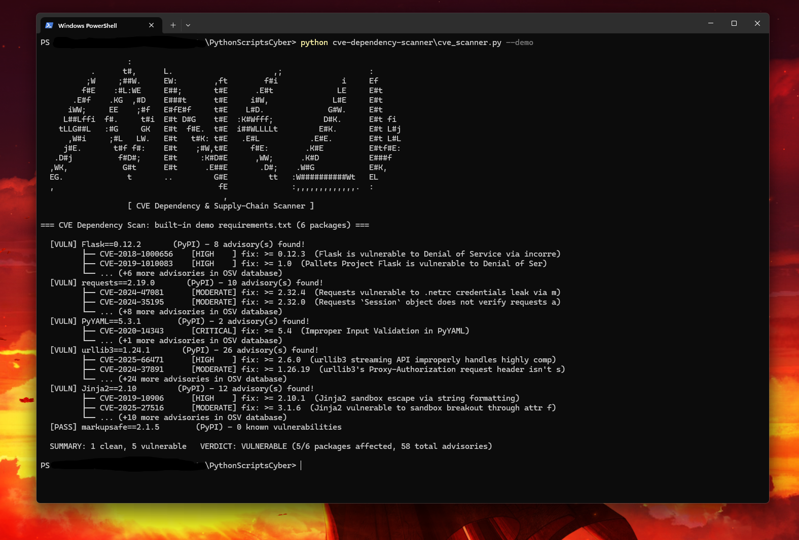

# 📦 CVE Dependency & Supply-Chain Scanner

A Python vulnerability-management tool that audits project dependency manifests (`requirements.txt` for Python/PyPI or `package.json` for Node.js/npm) against Google's live **[OSV.dev](https://osv.dev) vulnerability database** (no API key needed) and reports **CVE IDs**, **severity ratings**, **vulnerability summaries**, and the **minimum fixed version** to upgrade to.

## ✨ Features
- **Multi-ecosystem support:** parses both Python `requirements.txt` (`PyPI`) and Node.js `package.json` (`npm`)
- **Live CVE lookups (no API key required):** queries `https://api.osv.dev/v1/querybatch` in a single batch call and fetches full advisory details concurrently via `ThreadPoolExecutor`
- **Actionable remediation:** shows the exact version where each CVE was patched (`fix: >= X.Y.Z`)
- **CI/CD ready:** returns exit code `2` when vulnerabilities are detected, and supports `-o report.json` for pipeline artifacts
- **Built-in `--demo` manifest:** scans a sample set of legacy dependencies against the live OSV database out of the box
- Pure Python standard library, nothing to install

## 🎯 OWASP & MITRE ATT&CK Mapping
| Framework | Category |
|---|---|
| OWASP Top 10 | [A06:2021 — Vulnerable and Outdated Components](https://owasp.org/Top10/A06_2021-Vulnerable_and_Outdated_Components/) |
| MITRE ATT&CK | [T1195.001 — Supply Chain Compromise: Compromise Software Dependencies](https://attack.mitre.org/techniques/T1195/001/) |

## 🚀 Usage
Requires **Python 3.10+** and an internet connection.

```bash
# Run against the built-in sample requirements.txt
python cve_scanner.py --demo

# Scan a Python requirements.txt file
python cve_scanner.py path/to/requirements.txt

# Scan a Node.js package.json and save a JSON report
python cve_scanner.py path/to/package.json -o vuln_report.json
```

| Option | Description |
|---|---|
| `manifest` | Path to a `requirements.txt` or `package.json` file |
| `-o`, `--output` | Save full vulnerability details to a JSON file |
| `--demo` | Scan the built-in sample dependency manifest |

## 📊 Example Output


```
                   :                                                           
           .      t#,      L.                      ,;                   :      
          ;W     ;##W.     EW:        ,ft        f#i              i     Ef     
         f#E    :#L:WE     E##;       t#E      .E#t              LE     E#t    
       .E#f    .KG  ,#D    E###t      t#E     i#W,              L#E     E#t    
      iWW;     EE    ;#f   E#fE#f     t#E    L#D.              G#W.     E#t    
     L##Lffi  f#.     t#i  E#t D#G    t#E  :K#Wfff;           D#K.      E#t fi 
    tLLG##L   :#G     GK   E#t  f#E.  t#E  i##WLLLLt         E#K.       E#t L#j
      ,W#i     ;#L   LW.   E#t   t#K: t#E   .E#L           .E#E.        E#t L#L
     j#E.       t#f f#:    E#t    ;#W,t#E     f#E:        .K#E          E#tf#E:
   .D#j          f#D#;     E#t     :K#D#E      ,WW;      .K#D           E###f  
  ,WK,            G#t      E#t      .E##E       .D#;    .W#G            E#K,   
  EG.              t       ..         G#E         tt   :W##########Wt   EL     
  ,                                    fE              :,,,,,,,,,,,,,.  :      
                                        ,                                      
                   [ CVE Dependency & Supply-Chain Scanner ]

=== CVE Dependency Scan: built-in demo requirements.txt (6 packages) ===

  [VULN] Flask==0.12.2       (PyPI) - 8 advisory(s) found!
         ├── CVE-2018-1000656    [HIGH    ] fix: >= 0.12.3  (Flask is vulnerable to Denial of Service via incorre)
         ├── CVE-2019-1010083    [HIGH    ] fix: >= 1.0  (Pallets Project Flask is vulnerable to Denial of Ser)
         └── ... (+6 more advisories in OSV database)
  [VULN] requests==2.19.0       (PyPI) - 10 advisory(s) found!
         ├── CVE-2024-47081      [MODERATE] fix: >= 2.32.4  (Requests vulnerable to .netrc credentials leak via m)
         ├── CVE-2024-35195      [MODERATE] fix: >= 2.32.0  (Requests `Session` object does not verify requests a)
         └── ... (+8 more advisories in OSV database)
  [VULN] PyYAML==5.3.1        (PyPI) - 2 advisory(s) found!
         ├── CVE-2020-14343      [CRITICAL] fix: >= 5.4  (Improper Input Validation in PyYAML)
         └── ... (+1 more advisories in OSV database)
  [VULN] urllib3==1.24.1       (PyPI) - 26 advisory(s) found!
         ├── CVE-2025-66471      [HIGH    ] fix: >= 2.6.0  (urllib3 streaming API improperly handles highly comp)
         ├── CVE-2024-37891      [MODERATE] fix: >= 1.26.19  (urllib3's Proxy-Authorization request header isn't s)
         └── ... (+24 more advisories in OSV database)
  [VULN] Jinja2==2.10         (PyPI) - 12 advisory(s) found!
         ├── CVE-2019-10906      [HIGH    ] fix: >= 2.10.1  (Jinja2 sandbox escape via string formatting)
         ├── CVE-2025-27516      [MODERATE] fix: >= 3.1.6  (Jinja2 vulnerable to sandbox breakout through attr f)
         └── ... (+10 more advisories in OSV database)
  [PASS] markupsafe==2.1.5        (PyPI) - 0 known vulnerabilities

  SUMMARY: 1 clean, 5 vulnerable   VERDICT: VULNERABLE (5/6 packages affected, 58 total advisories)
```

## 🧠 What I Learned
- How software composition analysis (SCA) tools like `pip-audit`, `Dependabot`, and `Snyk` match package versions against advisory databases
- How OSV advisories map ecosystem-specific IDs (`GHSA-...`, `PYSEC-...`) to global `CVE-YYYY-NNNN` identifiers and affected version ranges
- Using batch API queries + thread pools to avoid slow sequential HTTP requests

## 🛣️ Future Improvements
- Scan remote GitHub repositories directly by URL
- Support `Pipfile.lock`, `poetry.lock`, and `package-lock.json`
- Auto-generate an upgraded `requirements.txt` with patched versions
