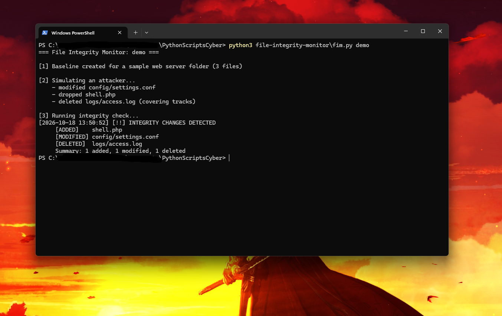

# 🗂️ File Integrity Monitor

A Python tool that detects when files are **added, modified, permission-changed, or deleted** in a folder. It saves a cryptographic SHA-256 fingerprint ("baseline") of every file—optionally signed with **`HMAC-SHA256`** so tampering with `baseline.json` itself is caught immediately—and compares the folder against it later to spot intrusion artifacts. This is the core mechanism behind host-based intrusion detection systems (HIDS) like **Tripwire, OSSEC, and Wazuh**.

## ✨ Features
- **SHA-256 File Fingerprinting & Metadata Tracking:** Hashes every file in chunks and records permissions (`mode`), file size, and modification timestamps (`mtime`)
- **Tamper-Proof `HMAC-SHA256` Signed Baselines (`-k / --key`):** Signs `baseline.json` with a secret key (or `FIM_SECRET_KEY` env var) and raises a critical alert if an attacker edits the baseline to hide their tracks
- **Ignore Rules (`--ignore` & `.fimignore`):** Supports glob patterns (`*.tmp`, `*.log`, `cache/*`, `__pycache__/*`) via CLI flags or a `.fimignore` file in the monitored folder
- **Live Webhook Alerting (`--webhook`) & JSON Export (`-o`):** Dispatches real-time alerts to Discord, Slack, or Microsoft Teams webhooks and exports machine-readable JSON integrity reports
- **Continuous `watch` Mode:** Polls at a configurable interval and alerts the moment files or permissions change
- **Built-in `--demo` Mode:** Simulates a multi-stage web server intrusion and baseline-tampering test in a temporary directory
- **Zero External Dependencies:** Pure Python standard library (`hashlib`, `hmac`, `fnmatch`, `urllib.request`)

## 🎯 MITRE ATT&CK Mapping
| What it can catch | Technique | ID |
|---|---|---|
| Changed config files or tampered baselines | Stored Data Manipulation | [T1565.001](https://attack.mitre.org/techniques/T1565/001/) |
| Web shells dropped on a server | Server Software Component: Web Shell | [T1505.003](https://attack.mitre.org/techniques/T1505/003/) |
| Suspicious `chmod` / SUID permission changes | File and Directory Permissions Modification | [T1222](https://attack.mitre.org/techniques/T1222/) |
| Deleted logs | Indicator Removal: File Deletion | [T1070.004](https://attack.mitre.org/techniques/T1070/004/) |

## 🚀 Usage
Requires **Python 3.10+**.

```bash
# Run the built-in simulated attack & HMAC anti-tamper demo
python fim.py --demo

# 1. Create an HMAC-signed baseline while ignoring *.tmp and cache/*
python fim.py baseline C:\path\to\folder --key "my-soc-secret" --ignore "*.tmp,cache/*"

# 2. Check for file & permission changes (verifying the HMAC signature)
python fim.py check --key "my-soc-secret" -o fim_report.json

# 3. Continuous watch mode with Slack/Discord webhook alerting
python fim.py watch -i 5 --key "my-soc-secret" --webhook https://discord.com/api/webhooks/...
```

| Command / Option | Description |
|---|---|
| `baseline <folder>` | Hash every file, record permissions/size, and save the baseline |
| `check [folder]` | Verify baseline signature and compare the folder once |
| `watch [folder]` | Keep checking on an interval and alert on new changes |
| `demo` / `--demo` | Run a simulated attack & baseline tampering test on a temp folder |
| `-b`, `--baseline` | Baseline file to use (default: `baseline.json`) |
| `-k`, `--key` | Secret key for `HMAC-SHA256` baseline signing/verification (or `FIM_SECRET_KEY` env var) |
| `--ignore` | Comma-separated glob patterns to ignore (plus `.fimignore` if present) |
| `--webhook` | Slack, Discord, or Teams webhook URL for real-time change alerts |
| `-o`, `--output` | Export integrity findings to a JSON report file |
| `-i`, `--interval` | Seconds between checks in `watch` mode (default: `10`) |

> **Tip:** Signing `baseline.json` with `--key` (or storing your key in the `FIM_SECRET_KEY` environment variable) guarantees that even if an attacker gains write access to `baseline.json` and replaces a file's SHA-256 hash, the `HMAC-SHA256` verification will fail with exit code `3`.

## 📊 Example Output


```text
                    [ File Integrity Monitor (FIM) v2.0 ]

[*] Target Folder   : /var/www/webserver (Simulated Temp Environment)
[*] Security Policy : HMAC-SHA256 Signed Baseline  |  Ignore Rules: *.tmp, cache/*
============================================================================

[1] Created HMAC-SHA256 Signed Baseline (3 files hashed, 1 *.tmp file ignored)

[2] Simulating Intrusion & File Tampering...
    • Modified config/settings.conf (privilege escalation)
    • Dropped shell.php in webroot (persistence)
    • Deleted logs/access.log (defense evasion)

[3] Verifying Baseline Signature & Running Integrity Check...
    • Baseline Signature : VALID (HMAC-SHA256 Verified)
[2026-10-27 17:57:08] [!!] INTEGRITY CHANGES DETECTED
     [ADDED]      shell.php  (MITRE T1505.003)
     [MODIFIED]   config/settings.conf  (MITRE T1565.001)
     [DELETED]    logs/access.log  (MITRE T1070.004)
     Summary: 1 added, 1 modified, 0 perm-changed, 1 deleted

[4] Simulating Attacker Editing baseline.json Directly (Anti-Tamper Test)...
    • [CRITICAL ALERT] TAMPERED (HMAC-SHA256 Mismatch — baseline.json was modified!)
============================================================================
```

## 🧠 What I Learned
- How cryptographic hashes (`SHA-256`) and keyed message authentication codes (`HMAC-SHA256`) work together: `SHA-256` fingerprints the files, while `HMAC-SHA256` proves the baseline file itself was not forged by an intruder
- How host-based intrusion detection systems (HIDS) track permission mutations (`T1222`) alongside content changes to catch `chmod` / SUID privilege escalation
- Designing noise-free monitoring policies with `.fimignore` glob filtering so volatile cache and temp files don't cause alert fatigue

## 🔄 Version History & Changelog (v1.0 → v2.0)
- **v1.0 (Initial Release):** Recursive `SHA-256` file hashing, `baseline` / `check` / `watch` / `demo` subcommands, detection of added, modified, and deleted files, and exit code `2` for automation.
- **v2.0:**
  - Added **Tamper-Proof `HMAC-SHA256` Signed Baselines (`-k / --key` & `FIM_SECRET_KEY`)** using constant-time `hmac.compare_digest` verification to detect direct tampering with `baseline.json`.
  - Added **Ignore Rules (`--ignore` & `.fimignore`)** supporting glob patterns (`*.tmp`, `cache/*`, `__pycache__/*`) to filter out noisy temporary files.
  - Added **File Permission (`mode`) & Size Metadata Tracking** to detect `chmod` permission changes (`MITRE T1222`) even when file contents are untouched.
  - Added **Real-Time Webhook Alerting (`--webhook`)** for Slack, Discord, and Teams plus **JSON Report Export (`-o`)** and `--demo` flag support.
