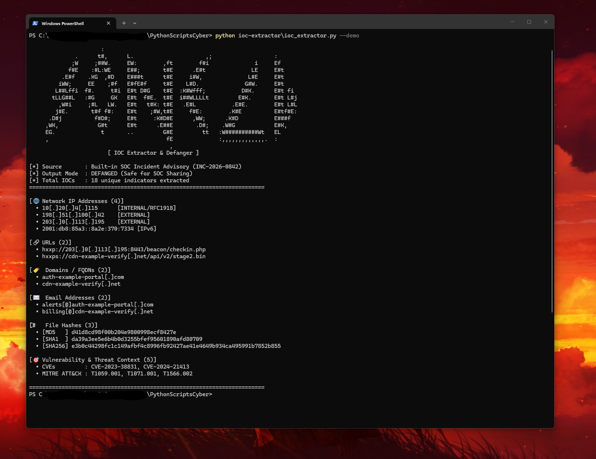

# 🔎 IOC Extractor & Defanger

A zero-dependency Python Blue Team / Threat Intelligence CLI tool that automatically **normalizes**, **extracts**, **validates**, and **defangs/refangs** **11 categories of Indicators of Compromise (IOCs)** from raw logs, phishing emails, malware sandbox reports, or threat advisories, and exports **OASIS STIX 2.1 Indicator Bundles (`--stix`)**.

---

## ✨ Features

- **Pre-Extraction Normalization (`refang_text`):** Automatically detects and normalizes already-obfuscated indicators (`hxxps://`, `[:]//`, `[.]`, `(.)`, `[@]`) so mixed threat reports are parsed with 100% recall.
- **11 IOC Categories Extracted & Deduplicated:**
  1. **IPv4 Addresses:** Validated via Python's `ipaddress.IPv4Address` and tagged as `[EXTERNAL]` vs. `[INTERNAL/RFC1918]`.
  2. **IPv6 Addresses:** Supports both standard and `::` compressed notation via `ipaddress.IPv6Address`.
  3. **URLs (`http`, `https`, `ftp`):** Preserves paths, ports, and query parameters while stripping trailing sentence punctuation.
  4. **Domains / FQDNs:** Filters out file extensions (`.exe`, `.dll`, `.elf`, `.bin`, `.php`, `.log`) so filenames in logs aren't misclassified as domains.
  5. **Email Addresses:** Extracts phishing senders and attacker contact addresses.
  6. **Cryptographic File Hashes:** Automatically separates **SHA-256** (64 hex), **SHA-1** (40 hex), and **MD5** (32 hex) without substring collisions.
  7. **Windows Registry Persistence Keys:** Extracts `HKLM\...`, `HKCU\...`, `HKEY_LOCAL_MACHINE\...` paths (`MITRE T1547.001`).
  8. **Windows & Linux File Paths:** Extracts suspicious host paths (`C:\Users\Public\...`, `/etc/cron.d/...`, `/tmp/...`).
  9. **Cryptocurrency Ransomware Wallets:** Extracts **Bitcoin (`bc1...` / `1...` / `3...`)** and **Monero (`4...`)** payment addresses (`MITRE T1486`).
  10. **CVE Vulnerability IDs:** Matches `CVE-YYYY-NNNN+` identifiers.
  11. **MITRE ATT&CK Technique IDs:** Extracts `Txxxx` and `Txxxx.xxx` sub-technique tags.
- **OASIS STIX 2.1 Bundle Generator (`--stix FILE`):** Exports deterministic `indicator--<uuid5>` SDO bundles ready for **OpenCTI** and **MISP**.
- **Optional Threat-Intel Enrichment (`--enrich`) & JSON/CSV Export (`-o`):** Checks extracted URLs against URLhaus and exports structured JSON/CSV files.

---

## 🎯 MITRE ATT&CK & Cyber Threat Intelligence (CTI) Mapping

| Capability | Framework / Use Case | Why It Matters |
|---|---|---|
| **Automated IOC & Host Artifact Harvesting** | **NIST SP 800-61r2** (Incident Handling) | Speeds up containment by extracting all network, host, and ransomware artifacts in seconds |
| **OASIS STIX 2.1 Bundle Export (`--stix`)** | **STIX 2.1 / OpenCTI / MISP** | Standardized cyber threat intelligence format for automated TIP and SIEM ingestion |
| **Indicator Defanging (`[.]`, `hxxps://`)** | **FIRST.org Traffic Light Protocol / SOC Hygiene** | Prevents analysts or stakeholders from accidentally clicking live C2/phishing links in tickets |
| **RFC 1918 vs. Public IP Classification** | **MITRE ATT&CK `T1071` (Application Layer Protocol)** | Immediately separates internal victim workstations (`10.x.x.x`) from external C2 infrastructure |

---

## 🚀 Usage

### 1. Run Built-in SOC Threat Advisory Demo
```bash
python ioc_extractor.py --demo
```

### 2. Extract IOCs & Generate an OASIS STIX 2.1 Bundle for OpenCTI / MISP
```bash
python ioc_extractor.py incident_notes.txt --stix bundle_stix21.json -o iocs.csv
```

### 3. Output Raw (Refanged) IOCs & Exclude Internal RFC 1918 IPs (For Firewall Blocklists)
```bash
python ioc_extractor.py incident_notes.txt --refang --no-private
```

### CLI Options
| Flag | Description |
|---|---|
| `file` | Path to any text, log, markdown, or `.eml` file (or pipe via `stdin`) |
| `--demo` | Run against the built-in simulated SOC Incident Advisory (`INC-2026-0842`) |
| `--refang` | Output raw/active indicators instead of defanged indicators |
| `--no-private` | Exclude internal RFC 1918 (`10.x`, `172.16.x`, `192.168.x`) and loopback IPs |
| `--stix FILE` | Export an OASIS STIX 2.1 Indicator Bundle (`.json`) |
| `--enrich` | Query URLhaus threat intelligence for extracted URLs |
| `-o`, `--output` | Export extracted IOCs to `.json` or `.csv` |

---

## 📊 Example Output



```text
                      [ IOC Extractor & Defanger v2.0 ]

[*] Source       : Built-in SOC Incident Advisory (INC-2026-0842)
[*] Output Mode  : DEFANGED (Safe for SOC Sharing)
[*] Total IOCs   : 22 unique indicators extracted across 11 classes
============================================================================

[🌐 Network IP Addresses (4)]
  • 10[.]20[.]4[.]115      [INTERNAL/RFC1918]
  • 198[.]51[.]100[.]42    [EXTERNAL]
  • 203[.]0[.]113[.]195    [EXTERNAL]
  • 2001:db8:85a3::8a2e:370:7334 [IPv6]

[🔗 URLs (2)]
  • hxxp://203[.]0[.]113[.]195:8443/beacon/checkin.php
  • hxxps://cdn-example-verify[.]net/api/v2/stage2.bin

[🏷️  Domains & Emails (4)]
  • [DOMAIN] auth-example-portal[.]com
  • [DOMAIN] cdn-example-verify[.]net
  • [EMAIL]  alerts[@]auth-example-portal[.]com
  • [EMAIL]  billing[@]cdn-example-verify[.]net

[🖥️  Host Artifacts & Ransomware Wallets (4)]
  • [REGISTRY] HKLM\SOFTWARE\Microsoft\Windows\CurrentVersion\Run\ShadowSync
  • [FILEPATH] /etc/cron.d/apache_healthcheck
  • [FILEPATH] C:\Users\Public\Music\svchost_update.exe
  • [WALLET]   bc1qar0srrr7xfkvy5l643lydnw9re59gtzzwf5mdq

[#️⃣  File Hashes (3)]
  • [MD5   ] d41d8cd98f00b204e9800998ecf8427e
  • [SHA1  ] da39a3ee5e6b4b0d3255bfef95601890afd80709
  • [SHA256] e3b0c44298fc1c149afbf4c8996fb92427ae41e4649b934ca495991b7852b855

[🎯 Vulnerability & Threat Context (5)]
  • CVEs         : CVE-2023-38831, CVE-2024-21413
  • MITRE ATT&CK : T1059.001, T1547.001, T1566.002

============================================================================
```

---

## 🧠 What I Learned

- **Normalize Before Extracting:** Threat intelligence feeds frequently mix live links (`http://...`) and partially defanged indicators (`hxxps://domain[.]com`). Normalizing (`refang_text`) before running extraction regexes ensures every indicator is captured and deduplicated cleanly.
- **OASIS STIX 2.1 Patterning:** Generating deterministic `uuid5` STIX `indicator` objects (`[ipv4-addr:value = '...']`, `[file:hashes.'SHA-256' = '...']`, `[windows-registry-key:key = '...']`) lets threat intelligence platforms like OpenCTI and MISP deduplicate indicators across multiple imports.
- **Eliminating Regex False Positives:** Combining `ipaddress.IPv4Address` validation with an explicit TLD allowlist/extension blocklist prevents filenames (`backdoor.elf`, `stage2.bin`) from being misclassified as domains.

---

## 🔄 Version History & Changelog (v1.0 → v2.0)

- **v1.0 (Initial Release):** Extraction, validation, and defanging/refanging of 8 indicator types (`IPv4`, `IPv6`, `URLs`, `Domains`, `Emails`, `MD5`/`SHA-1`/`SHA-256`, `CVEs`, and `MITRE ATT&CK` IDs) with JSON/CSV export.
- **v2.0:**
  - Added **OASIS STIX 2.1 Bundle Generator (`--stix FILE`)** with deterministic `uuid5` indicator SDOs ready for direct import into OpenCTI and MISP.
  - Added **Host & Ransomware Artifact Extraction** covering **Windows Registry persistence keys** (`HKLM\...`, `HKCU\...`), **Windows/Linux file paths**, and **Bitcoin/Monero ransomware wallet addresses**.
  - Added **Optional URLhaus Threat-Intelligence Enrichment (`--enrich`)** and strict TLD validation to prevent 3-letter binary extensions (`.elf`, `.tmp`) from matching as domains.
