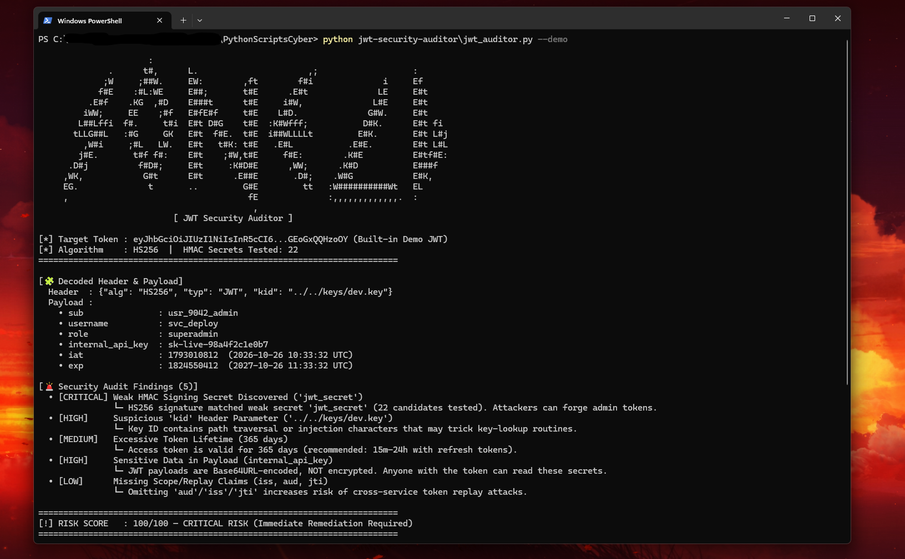

# 🔑 JWT Security Auditor

A zero-dependency Python Application Security / Red Team CLI tool that decodes **JSON Web Tokens (JWT, RFC 7519)**, audits headers and claims against **OWASP API2:2023 (Broken Authentication)** and **OWASP A07:2021** best practices, and tests HMAC (`HS256`/`HS384`/`HS512`) signatures against common weak or default secrets.

---

## ✨ Features

- **RFC 7515 Base64URL Decoder:** Automatically restores stripped `=` padding, strips optional `Bearer ` prefixes, and pretty-prints the decoded **Header** and **Payload** with human-readable UTC timestamps (`iat`, `nbf`, `exp`).
- **Cryptographic & Header Security Checks:**
  - **`alg: none` & Missing Signature Detection (`CRITICAL`):** Catches tokens that bypass signature verification (`CVE-2015-2951`).
  - **Weak HMAC Secret Auditing (`CRITICAL`):** Recomputes `HS256`, `HS384`, and `HS512` signatures using `hmac` + `hashlib` and constant-time `hmac.compare_digest()` against a built-in dictionary of common development secrets (or a custom `-w wordlist.txt`).
  - **Dynamic Key & `kid` Injection (`HIGH`):** Flags dangerous header parameters (`jku`, `jwk`, `x5u`) and `kid` values containing path traversal (`../`) or SQL injection characters.
- **Claims & Token Lifetime Auditing:**
  - **Expiration (`exp`) Analysis (`HIGH` / `MEDIUM`):** Detects immortal tokens missing `exp`, expired tokens, or long-lived access tokens (> 7 days).
  - **Cleartext Secret Exposure (`HIGH`):** Scans unencrypted payload claims for leaked credentials (`password`, `api_key`, `internal_api_key`, `secret`, `private_key`, `ssn`).
  - **Replay & Scope Hygiene (`LOW`):** Checks for missing standard claims (`iss`, `aud`, `jti`).
- **Automated Risk Scoring (0–100) & JSON Export (`-o`):** Summarizes findings into an actionable security verdict (`LOW` to `CRITICAL RISK`).

---

## 🎯 OWASP & CWE Mapping

| Check | OWASP / CWE Reference | Security Impact |
|---|---|---|
| **`alg: none` / Weak HMAC Secret** | **OWASP API2:2023 (Broken Authentication)** / `CWE-347` | Allows attackers to forge arbitrary `role: admin` session tokens |
| **`kid` Path Traversal / `jku` Header** | **OWASP A07:2021 (Auth Failures)** / `CWE-22` | Tricks server into verifying signatures against attacker-controlled files or URLs |
| **Sensitive Claims in Payload** | **OWASP A02:2021 (Cryptographic Failures)** / `CWE-312` | JWT payloads are Base64URL-encoded, not encrypted; any client or proxy can read them |
| **Missing `exp` / Excessive TTL** | **OWASP ASVS v4.0 (V3.5 Token-Based Session Mgmt)** / `CWE-613` | Stolen tokens remain valid indefinitely without a short expiration window |

---

## 🚀 Usage

### 1. Run Built-in Vulnerable JWT Audit Demo
```bash
python jwt_auditor.py --demo
```

### 2. Audit a Raw JWT String (or File Containing a Token)
```bash
python jwt_auditor.py "eyJhbGciOiJIUzI1NiIsInR5cCI6IkpXVCJ9..."
python jwt_auditor.py token.txt
```

### 3. Audit Against a Custom Wordlist or Specific Secret Key
```bash
python jwt_auditor.py token.txt -w custom_secrets.txt
python jwt_auditor.py token.txt -s "my_suspected_secret"
```

### 4. Export Full Audit Report to JSON
```bash
python jwt_auditor.py --demo -o jwt_audit.json
```

### CLI Options
| Flag | Description |
|---|---|
| `token` | Raw JWT string (`eyJ...`, with or without `Bearer `) or path to a file |
| `--demo` | Audit a built-in vulnerable sample JWT |
| `-w`, `--wordlist` | Path to a custom newline-delimited wordlist for HMAC secret testing |
| `-s`, `--secret` | Test a specific candidate HMAC secret key |
| `-o`, `--output` | Export the audit report to a `.json` file |

---

## 📊 Example Output



```text
                      :                                                           
              .      t#,      L.                      ,;                   :      
             ;W     ;##W.     EW:        ,ft        f#i              i     Ef     
            f#E    :#L:WE     E##;       t#E      .E#t              LE     E#t    
          .E#f    .KG  ,#D    E###t      t#E     i#W,              L#E     E#t    
         iWW;     EE    ;#f   E#fE#f     t#E    L#D.              G#W.     E#t    
        L##Lffi  f#.     t#i  E#t D#G    t#E  :K#Wfff;           D#K.      E#t fi 
       tLLG##L   :#G     GK   E#t  f#E.  t#E  i##WLLLLt         E#K.       E#t L#j
         ,W#i     ;#L   LW.   E#t   t#K: t#E   .E#L           .E#E.        E#t L#L
        j#E.       t#f f#:    E#t    ;#W,t#E     f#E:        .K#E          E#tf#E:
      .D#j          f#D#;     E#t     :K#D#E      ,WW;      .K#D           E###f  
     ,WK,            G#t      E#t      .E##E       .D#;    .W#G            E#K,   
     EG.              t       ..         G#E         tt   :W##########Wt   EL     
     ,                                    fE              :,,,,,,,,,,,,,.  :      
                                           ,                                      
                           [ JWT Security Auditor ]

[*] Target Token : eyJhbGciOiJIUzI1NiIsInR5cCI6...XBk4ItxZvPuw (Built-in Demo JWT)
[*] Algorithm    : HS256  |  HMAC Secrets Tested: 22
========================================================================

[🧩 Decoded Header & Payload]
  Header  : {"alg": "HS256", "typ": "JWT", "kid": "../../keys/dev.key"}
  Payload :
    • sub               : usr_9042_admin
    • username          : svc_deploy
    • role              : superadmin
    • internal_api_key  : sk-live-98a4f2c1e0b7
    • iat               : 1793010720  (2026-10-26 10:32:00 UTC)
    • exp               : 1824550320  (2027-10-26 11:32:00 UTC)

[🚨 Security Audit Findings (5)]
  • [CRITICAL] Weak HMAC Signing Secret Discovered ('jwt_secret')
               └─ HS256 signature matched weak secret 'jwt_secret' (22 candidates tested). Attackers can forge admin tokens.
  • [HIGH]     Suspicious 'kid' Header Parameter ('../../keys/dev.key')
               └─ Key ID contains path traversal or injection characters that may trick key-lookup routines.
  • [MEDIUM]   Excessive Token Lifetime (365 days)
               └─ Access token is valid for 365 days (recommended: 15m–24h with refresh tokens).
  • [HIGH]     Sensitive Data in Payload (internal_api_key)
               └─ JWT payloads are Base64URL-encoded, NOT encrypted. Anyone with the token can read these secrets.
  • [LOW]      Missing Scope/Replay Claims (iss, aud, jti)
               └─ Omitting 'aud'/'iss'/'jti' increases risk of cross-service token replay attacks.

========================================================================
[!] RISK SCORE   : 100/100 — CRITICAL RISK (Immediate Remediation Required)
========================================================================
```

---

## 🧠 What I Learned

- **Base64 vs. Base64URL Padding:** JWTs use RFC 7515 Base64URL encoding (`-` and `_` instead of `+` and `/`, with trailing `=` padding stripped). Restoring `=` padding via `len(segment) % 4` is required before passing segments to Python's `base64.urlsafe_b64decode()`.
- **Encoding != Encryption:** Developers frequently store internal API keys or sensitive user attributes in JWT payloads assuming the opaque-looking string is encrypted, when in reality only JWE (JSON Web Encryption) encrypts payload contents.
- **Constant-Time Signature Verification:** Using `hmac.compare_digest()` instead of `==` is critical in production JWT libraries to prevent timing side-channel attacks on HMAC signatures.

---

## 🛣️ Future Improvements

- **JWKS Endpoint Fetching (`/.well-known/openid-configuration`):** Automatically fetch public keys from an issuer's JWKS endpoint to verify `RS256` / `ES256` signatures and check key rotation policies.
- **Algorithm Confusion (`RS256` → `HS256`) Assessment:** Check if a server's public RSA key (`pubkey.pem`) is mistakenly accepted as an HMAC secret.
- **Batch HTTP Log / HAR File Scanning:** Extract and audit all `Authorization: Bearer eyJ...` tokens from `.har` captures or proxy logs automatically.
