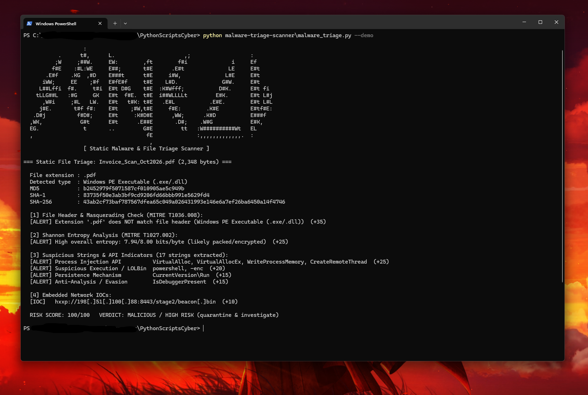

# 🧬 Static Malware & File Triage Scanner

A Python incident-response and SOC triage tool that inspects suspicious files **statically** (reading raw bytes only — never executing the file) to detect **masqueraded executables**, **packed or encrypted payloads**, and **high-risk API/command strings**.

## ✨ Features
- **Cryptographic Fingerprinting:** computes `MD5`, `SHA-1`, and `SHA-256` hashes for immediate lookup on VirusTotal or MalwareBazaar
- **Magic-Byte Verification (MITRE T1036.008):** inspects the raw file header (`MZ`, `\x7fELF`, `%PDF-`, `PNG`, `JPEG`, `PK`) and alerts when a file's extension (e.g. `.pdf` or `.jpg`) disguises an executable binary
- **Shannon Entropy Analysis (MITRE T1027.002):** calculates overall entropy (`0.00–8.00 bits/byte`) and peak 1 KB block entropy to detect packed, compressed, or encrypted sections
- **YARA-Style String & API Triage:** extracts printable ASCII and UTF-16LE strings and scans for:
  - **Process Injection APIs:** `VirtualAllocEx`, `WriteProcessMemory`, `CreateRemoteThread`, `NtUnmapViewOfSection`
  - **Suspicious Execution / LOLBins:** `powershell`, `-enc`, `FromBase64String`, `cmd.exe /c`, `WScript.Shell`, `certutil -urlcache`
  - **Persistence & Anti-Analysis:** `CurrentVersion\Run`, `schtasks /create`, `IsDebuggerPresent`, `AmsiScanBuffer`
- **Safe IOC Extraction:** pulls embedded URLs out of the binary and prints them **defanged** (`hxxp://198[.]51[.]100[.]88/...`)
- **Built-in `--demo` sample:** generates a harmless in-memory byte buffer mimicking a masqueraded dropper (`Invoice_Scan_Oct2026.pdf` starting with `MZ` magic bytes) so you can test it safely

## 🎯 MITRE ATT&CK Mapping
| Detection | Technique | ID |
|---|---|---|
| Extension vs. Magic-Byte Mismatch | Masquerading: Masquerade File Type | [T1036.008](https://attack.mitre.org/techniques/T1036/008/) |
| High Shannon Entropy (`>= 7.2`) | Obfuscated Files or Information: Software Packing | [T1027.002](https://attack.mitre.org/techniques/T1027/002/) |
| Memory Injection APIs | Process Injection | [T1055](https://attack.mitre.org/techniques/T1055/) |
| Encoded PowerShell / LOLBins | Command and Scripting Interpreter: PowerShell | [T1059.001](https://attack.mitre.org/techniques/T1059/001/) |

## 🚀 Usage
Requires **Python 3.10+**.

```bash
# Run against the built-in harmless demo sample
python malware_triage.py --demo

# Triage any suspicious file on disk (read-only, never executed)
python malware_triage.py path/to/suspicious_file.bin
```

| Option | Description |
|---|---|
| `file` | Path to a file to inspect statically |
| `--demo` | Run against a built-in simulated masqueraded dropper in memory |

## 📊 Example Output


```
                   :                                                           
           .      t#,      L.                      ,;                   :      
          ;W     ;##W.     EW:        ,ft        f#i              i     Ef     
         f#E    :#L:WE     E##;       t#E      .E#t              LE     E#t    
       .E#f    .KG  ,#D    E###t      t#E     i#W,              L#E     E#t    
      iWW;     EE    ;#f   E#fE#f     t#E    L#D.              G#W.     E#t    
     L##Lffi  f#.     t#i  E#t D#G    t#E  :K#Wfff;           D#K.      E#t fi 
    tLLG##L   :#G     GK   E#t  f#E.  t#E  i##WLLLLt         E#K.       E#t L#j
      ,W#i     ;#L   LW.   E#t   t#K: t#E   .E#L           .E#E.        E#t L#L
     j#E.       t#f f#:    E#t    ;#W,t#E     f#E:        .K#E          E#tf#E:
   .D#j          f#D#;     E#t     :K#D#E      ,WW;      .K#D           E###f  
  ,WK,            G#t      E#t      .E##E       .D#;    .W#G            E#K,   
  EG.              t       ..         G#E         tt   :W##########Wt   EL     
  ,                                    fE              :,,,,,,,,,,,,,.  :      
                                        ,                                      
                   [ Static Malware & File Triage Scanner ]

=== Static File Triage: Invoice_Scan_Oct2026.pdf (2,348 bytes) ===

  File extension : .pdf
  Detected type  : Windows PE Executable (.exe/.dll)
  MD5            : b2452979f5071587cf010905ae5c949b
  SHA-1          : 83735f50e3ab3bf9cd9206fd66bbb991e5629fd4
  SHA-256        : 43ab2cf73baf787567dfea65c049a026431993e146e6a7ef26ba6450a14f4746

  [1] File Header & Masquerading Check (MITRE T1036.008):
  [ALERT] Extension '.pdf' does NOT match file header (Windows PE Executable (.exe/.dll))  (+35)

  [2] Shannon Entropy Analysis (MITRE T1027.002):
  [ALERT] High overall entropy: 7.94/8.00 bits/byte (likely packed/encrypted)  (+25)

  [3] Suspicious Strings & API Indicators (17 strings extracted):
  [ALERT] Process Injection API          VirtualAlloc, VirtualAllocEx, WriteProcessMemory, CreateRemoteThread  (+25)
  [ALERT] Suspicious Execution / LOLBin  powershell, -enc  (+20)
  [ALERT] Persistence Mechanism          CurrentVersion\Run  (+15)
  [ALERT] Anti-Analysis / Evasion        IsDebuggerPresent  (+15)

  [4] Embedded Network IOCs:
  [IOC]   hxxp://198[.]51[.]100[.]88:8443/stage2/beacon[.]bin  (+10)

  RISK SCORE: 100/100   VERDICT: MALICIOUS / HIGH RISK (quarantine & investigate)
```

## 🧠 What I Learned
- Why file extensions cannot be trusted and how magic bytes (`MZ` / `4D 5A` for Windows PE, `7F 45 4C 46` for Linux ELF) identify the true file format
- How **Shannon entropy** measures randomness from `0` to `8` bits per byte, and why packed or encrypted malware sections approach `8.0`
- What Windows API combinations (`VirtualAllocEx` + `WriteProcessMemory` + `CreateRemoteThread`) indicate classic remote process injection

## 🛣️ Future Improvements
- Parse full PE section tables (`.text`, `.rdata`, `.rsrc`) and calculate per-section entropy
- Compute Import Hash (`imphash`) to cluster related malware families
- Add custom YARA rule file loading
