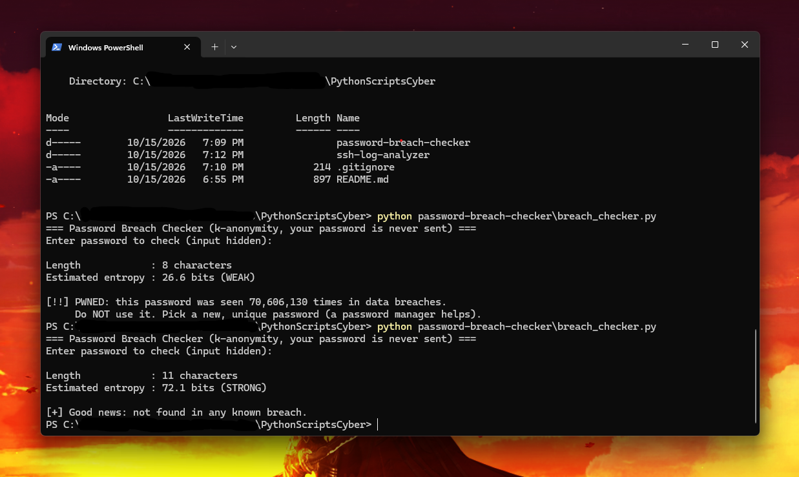

# 🔐 Password Breach & Entropy Auditor

A Python tool that privately audits whether passwords have appeared in **800M+ known data breaches** using the [Have I Been Pwned](https://haveibeenpwned.com/Passwords) **k-anonymity** API (only the first 5 characters of the `SHA-1` hash ever leave your machine), evaluates **pattern-adjusted entropy** (catching keyboard walks, leetspeak root words, and predictable years/seasons), and includes a **cryptographic CSRNG password & Diceware passphrase generator (`--generate`)**.

## ✨ Features
- **Privacy-Preserving k-Anonymity Lookup:** Sends only the 5-character `SHA-1` prefix (`Add-Padding: true`) with in-memory prefix caching for fast batch audits
- **Batch File Auditing Mode (`-f passwords.txt`):** Audits lists of candidate passwords and masks credentials (`Pa******3!`) in terminal and exported reports
- **Advanced Pattern & Weakness Detector:** Penalizes raw character-pool entropy when human-predictable patterns are present:
  - **Keyboard walks:** `qwerty`, `asdfgh`, `zxcvbn`, `123456`
  - **Leetspeak & dictionary roots:** `P@ssw0rd` → normalized to `password`
  - **Predictable years & seasons:** `1990–2029`, `Summer`, `Winter`, `Spring`, `Autumn`
  - **Repeated character runs:** `aaaa`, `1111`
- **Cryptographic Credential Generator (`--generate`):** Uses Python's `secrets` CSRNG module to generate a 20-character high-entropy password (`~131.1 bits`) and a 5-word Diceware passphrase (`~72.5 bits`)
- **JSON & CSV Audit Report Export (`-o`) + Built-in `--demo` Mode**

## 🛡️ How k-Anonymity Works
1. The password is hashed locally with `SHA-1`, e.g. `5BAA61E4C9B93F3F0682250B6CF8331B7EE68FD8`
2. Only the **first 5 characters** (`5BAA6`) are sent to the HIBP API
3. The API returns every hash suffix starting with `5BAA6` (with `Add-Padding: true` to prevent response-size traffic analysis)
4. The script compares the remaining 35 characters **locally on your computer**

## 🚀 Usage
Requires **Python 3.10+**.

```bash
# Run built-in credential audit & generator demo
python breach_checker.py --demo --generate

# Interactive single-password check (input hidden via getpass)
python breach_checker.py

# Batch audit a file of candidate passwords and export CSV or JSON report
python breach_checker.py -f passwords.txt -o audit_report.csv

# Generate cryptographic random passwords & passphrases only
python breach_checker.py --generate
```

| Option | Description |
|---|---|
| `-p`, `--password` | Check a single password from the command line |
| `-f`, `--file` | Batch audit a file of passwords (one per line) |
| `--generate` | Generate a 20-char CSRNG password & 5-word Diceware passphrase |
| `-o`, `--output` | Export audit results to `.json` or `.csv` |
| `--demo` | Run built-in credential set audit |

## 📊 Example Output


```text
                 [ Password Breach & Entropy Auditor v2.0 ]

[🔐 Cryptographic Credential Generator (Python secrets CSRNG)]
  • Random 20-char Password : 77vXa@$Cpj77kunrYF8m  (~131.1 bits entropy)
  • 5-Word Passphrase       : nimbus-crimson-phoenix-jungle-cedar-16!  (~72.5 bits entropy)
================================================================================
[*] Audit Source    : Built-in Sample Credential Set (4 candidates)
[*] Privacy Mode    : HIBP k-Anonymity (5-char SHA-1 prefix + response padding)
[*] Summary         : 4 audited -> 3 breached, 1 unbreached
================================================================================

  • Pa******3!   | Len: 12 | Prefix: 49EFE | Eff. Entropy:  64.7 bits | PWNED (295,389 breaches)
      ├─ Verdict  : CRITICAL / COMPROMISED
      └─ Patterns : Dictionary root ('password')

  • P@******24   | Len: 12 | Prefix: E894A | Eff. Entropy:  50.7 bits | PWNED (21,349 breaches)
      ├─ Verdict  : CRITICAL / COMPROMISED
      └─ Patterns : Leetspeak substitution of 'password', Predictable year ('2024')

  • qw******56   | Len: 12 | Prefix: F3BA3 | Eff. Entropy:  34.0 bits | PWNED (1,281,077 breaches)
      ├─ Verdict  : CRITICAL / COMPROMISED
      └─ Patterns : Keyboard walk ('qwerty'), Dictionary root ('qwerty')

  • CR******D0   | Len: 20 | Prefix: 683AC | Eff. Entropy: 131.1 bits | CLEAN (0 breaches)
      ├─ Verdict  : VERY STRONG
      └─ Patterns : None (no keyboard walks, leetspeak roots, or years detected)

================================================================================
```

## 🧠 What I Learned
- Why naive character-set entropy (`L * log2(pool)`) overestimates the strength of human passwords like `P@ssw0rd2024` (which uses upper, lower, digits, and symbols yet is cracked in milliseconds by Hashcat rule sets)
- How **k-anonymity** + HTTP response padding (`Add-Padding: true`) protects sensitive queries against both server logging and network traffic analysis
- Why Python's `secrets` module (backed by `os.urandom`) must be used instead of `random` when generating cryptographic credentials

## 🔄 Version History & Changelog (v1.0 → v2.0)
- **v1.0 (Initial Release):** Single interactive `getpass` prompt, HIBP k-anonymity lookup, and basic character-pool entropy calculation.
- **v2.0:**
  - Added **Batch File Auditing Mode (`-f passwords.txt`)** with `SHA-1` prefix caching and automatic credential masking (`Pa******3!`).
  - Added **Advanced Pattern & Weakness Detector** to flag keyboard walks (`qwerty`), leetspeak root words (`P@ssw0rd`), predictable years (`1970–2029`), seasons (`Summer2025!`), and repeated runs.
  - Added **Cryptographic CSRNG Password & Diceware Passphrase Generator (`--generate`)** using Python's `secrets` module.
  - Added **JSON & CSV Audit Report Export (`-o`)**, built-in `--demo` mode, and the `Def Leppard` `Sonelu` ASCII banner.
