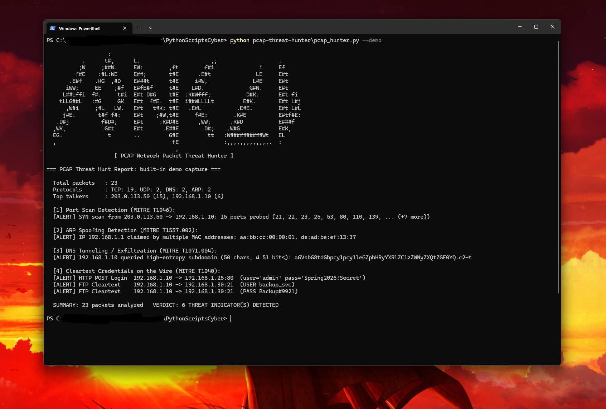

# 🕵️‍♂️ PCAP Network Packet Threat Hunter

A Python network forensics tool that parses binary `.pcap` packet captures at the **raw byte level** (Ethernet, ARP, IPv4, TCP, UDP, DNS) without requiring Wireshark or third-party libraries, and hunts for **four classes of network attacks**.

## ✨ Features
- **Zero-dependency binary `.pcap` parser:** unpacks Ethernet frames, ARP packets, IPv4 headers, TCP flags (`SYN`, `ACK`), UDP datagrams, and DNS query labels using Python's `struct` module
- **4 Built-in Threat Detections:**
  1. **TCP SYN Port Scans:** spots hosts sending `SYN`-only packets across many distinct ports on a target
  2. **ARP Spoofing / Cache Poisoning:** alerts when multiple MAC addresses claim the same IPv4 address (e.g., an attacker impersonating the default gateway)
  3. **DNS Tunneling / Exfiltration:** calculates **Shannon entropy** on DNS query labels to flag long, base64/hex-encoded subdomains used for C2 or data exfiltration
  4. **Cleartext Credentials in Transit:** extracts unencrypted HTTP Basic Auth headers, HTTP `POST` login bodies (`username`/`password`), and FTP `USER`/`PASS` commands
- **Built-in `--demo` capture generator:** builds a valid binary `.pcap` in memory containing normal traffic plus all 4 simulated attacks (and can export it with `--save-demo sample.pcap` so you can inspect it in Wireshark!)

## 🎯 MITRE ATT&CK Mapping
| Detection | Technique | ID |
|---|---|---|
| TCP SYN Port Scan | Network Service Discovery | [T1046](https://attack.mitre.org/techniques/T1046/) |
| ARP Spoofing | Adversary-in-the-Middle: ARP Cache Poisoning | [T1557.002](https://attack.mitre.org/techniques/T1557/002/) |
| DNS Tunneling | Application Layer Protocol: DNS | [T1071.004](https://attack.mitre.org/techniques/T1071/004/) |
| Cleartext Credentials | Network Sniffing | [T1040](https://attack.mitre.org/techniques/T1040/) |

## 🚀 Usage
Requires **Python 3.10+**.

```bash
# Run against the built-in simulated attack capture
python pcap_hunter.py --demo

# Analyze a real Wireshark / tcpdump .pcap file
python pcap_hunter.py capture.pcap

# Custom port-scan threshold (default: 10 ports)
python pcap_hunter.py capture.pcap -t 20

# Export the built-in demo capture as a real .pcap file to open in Wireshark
python pcap_hunter.py --save-demo demo_traffic.pcap
```

| Option | Description |
|---|---|
| `pcap` | Path to a `.pcap` file to analyze |
| `-t`, `--threshold` | Distinct ports before flagging a SYN scan (default: 10) |
| `--demo` | Run against the built-in simulated `.pcap` capture |
| `--save-demo FILE` | Save the built-in demo capture to disk (compatible with Wireshark) |

## 📊 Example Output


```
                   :                                                           
           .      t#,      L.                      ,;                   :      
          ;W     ;##W.     EW:        ,ft        f#i              i     Ef     
         f#E    :#L:WE     E##;       t#E      .E#t              LE     E#t    
       .E#f    .KG  ,#D    E###t      t#E     i#W,              L#E     E#t    
      iWW;     EE    ;#f   E#fE#f     t#E    L#D.              G#W.     E#t    
     L##Lffi  f#.     t#i  E#t D#G    t#E  :K#Wfff;           D#K.      E#t fi 
    tLLG##L   :#G     GK   E#t  f#E.  t#E  i##WLLLLt         E#K.       E#t L#j
      ,W#i     ;#L   LW.   E#t   t#K: t#E   .E#L           .E#E.        E#t L#L
     j#E.       t#f f#:    E#t    ;#W,t#E     f#E:        .K#E          E#tf#E:
   .D#j          f#D#;     E#t     :K#D#E      ,WW;      .K#D           E###f  
  ,WK,            G#t      E#t      .E##E       .D#;    .W#G            E#K,   
  EG.              t       ..         G#E         tt   :W##########Wt   EL     
  ,                                    fE              :,,,,,,,,,,,,,.  :      
                                        ,                                      
                     [ PCAP Network Packet Threat Hunter ]

=== PCAP Threat Hunt Report: built-in demo capture ===

  Total packets   : 23
  Protocols       : TCP: 19, UDP: 2, DNS: 2, ARP: 2
  Top talkers     : 203.0.113.50 (15), 192.168.1.10 (6)

  [1] Port Scan Detection (MITRE T1046):
  [ALERT] SYN scan from 203.0.113.50 -> 192.168.1.10: 15 ports probed (21, 22, 23, 25, 53, 80, 110, 139, ... (+7 more))

  [2] ARP Spoofing Detection (MITRE T1557.002):
  [ALERT] IP 192.168.1.1 claimed by multiple MAC addresses: aa:bb:cc:00:00:01, de:ad:be:ef:13:37

  [3] DNS Tunneling / Exfiltration (MITRE T1071.004):
  [ALERT] 192.168.1.10 queried high-entropy subdomain (50 chars, 4.51 bits): aGVsbG8tdGhpcy1pcy1leGZpbHRyYXRlZC1zZWNyZXQtZGF0YQ.c2-t

  [4] Cleartext Credentials on the Wire (MITRE T1040):
  [ALERT] HTTP POST Login  192.168.1.10 -> 192.168.1.25:80  (user='admin' pass='Spring2026!Secret')
  [ALERT] FTP Cleartext    192.168.1.10 -> 192.168.1.30:21  (USER backup_svc)
  [ALERT] FTP Cleartext    192.168.1.10 -> 192.168.1.30:21  (PASS Backup#9921)

  SUMMARY: 23 packets analyzed   VERDICT: 6 THREAT INDICATOR(S) DETECTED
```

## 🧠 What I Learned
- How `.pcap` global headers (`24 bytes`) and packet headers (`16 bytes`) are structured in binary
- Unpacking raw Ethernet (`14 bytes`), IPv4 (`IHL`), TCP (`flags` byte), ARP, and DNS wire-format length-prefixed labels
- How SOC analysts spot **DNS tunneling** using subdomain length and Shannon entropy rather than static domain blocklists

## 🛣️ Future Improvements
- Support `.pcapng` format and IPv6 headers
- Detect ICMP tunneling and unusual payload sizes
- Reassemble full TCP streams across multiple packets
