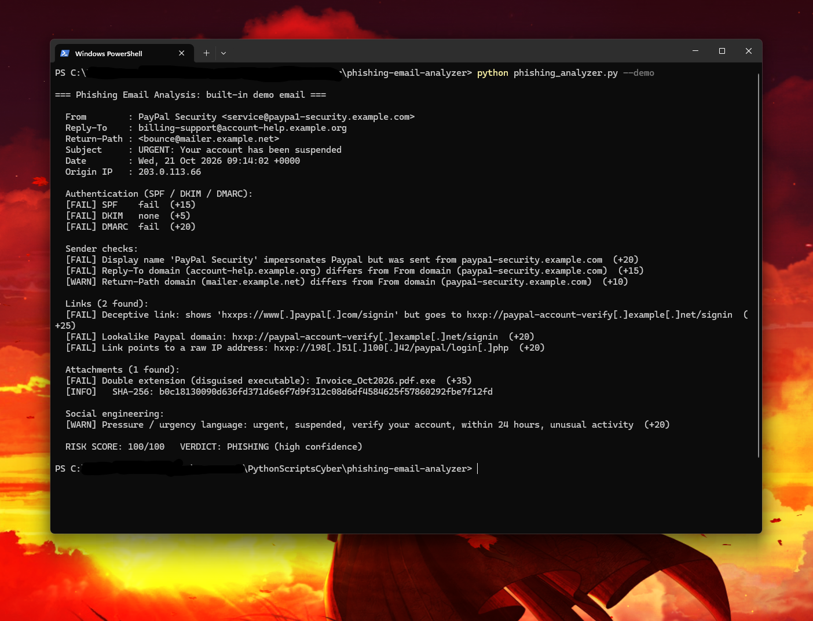

# 📧 Phishing Email Analyzer

A Python tool that triages a suspicious email (`.eml` file) the way a **SOC analyst** would. It checks sender spoofing, SPF/DKIM/DMARC results, deceptive links, dangerous attachments and pressure tactics, then gives a **risk score and verdict**.

## ✨ Features
- **Sender checks:** brand impersonation in the display name, and mismatched `Reply-To` / `Return-Path` domains
- **Email authentication:** reads SPF, DKIM and DMARC results from the headers
- **Link analysis:**
  - Deceptive links (the text shows `paypal.com` but the link goes somewhere else)
  - Raw IP addresses, lookalike brand domains, punycode (`xn--`) and URL shorteners
- **Attachment checks:** dangerous file types and **double extensions** (`Invoice.pdf.exe`), plus the SHA-256 hash for threat-intel lookups
- **Social engineering:** spots urgency and pressure language
- **Safe by design:** URLs are printed **defanged** (`hxxp://evil[.]com`) so they can't be clicked, and attachments are never opened or run
- Built-in `--demo` email, so no real phishing sample is needed
- Pure Python standard library, nothing to install

## 🎯 MITRE ATT&CK Mapping
| Technique | ID |
|---|---|
| Phishing: Spearphishing Attachment | [T1566.001](https://attack.mitre.org/techniques/T1566/001/) |
| Phishing: Spearphishing Link | [T1566.002](https://attack.mitre.org/techniques/T1566/002/) |

## 🚀 Usage
Requires **Python 3.9+**.

```bash
# Try it with the built-in sample phishing email
python phishing_analyzer.py --demo

# Analyze a real email
python phishing_analyzer.py suspicious.eml
```

**How to get a `.eml` file:**
- **Gmail:** open the email → ⋮ menu → *Download message*
- **Outlook (web):** open the email → ⋯ → *Save as*. In the desktop app, drag the email to a folder.
- **Thunderbird:** *File* → *Save As* → *File*

## 📊 Example Output


```
=== Phishing Email Analysis: built-in demo email ===

  From        : PayPal Security <service@paypa1-security.example.com>
  Reply-To    : billing-support@account-help.example.org
  Return-Path : <bounce@mailer.example.net>
  Subject     : URGENT: Your account has been suspended
  Date        : Wed, 21 Oct 2026 09:14:02 +0000
  Origin IP   : 203.0.113.66

  Authentication (SPF / DKIM / DMARC):
  [FAIL] SPF    fail  (+15)
  [FAIL] DKIM   none  (+5)
  [FAIL] DMARC  fail  (+20)

  Sender checks:
  [FAIL] Display name 'PayPal Security' impersonates Paypal but was sent from paypa1-security.example.com  (+20)
  [FAIL] Reply-To domain (account-help.example.org) differs from From domain (paypa1-security.example.com)  (+15)
  [WARN] Return-Path domain (mailer.example.net) differs from From domain (paypa1-security.example.com)  (+10)

  Links (2 found):
  [FAIL] Deceptive link: shows 'hxxps://www[.]paypal[.]com/signin' but goes to hxxp://paypal-account-verify[.]example[.]net/signin  (+25)
  [FAIL] Lookalike Paypal domain: hxxp://paypal-account-verify[.]example[.]net/signin  (+20)
  [FAIL] Link points to a raw IP address: hxxp://198[.]51[.]100[.]42/paypal/login[.]php  (+20)

  Attachments (1 found):
  [FAIL] Double extension (disguised executable): Invoice_Oct2026.pdf.exe  (+35)
  [INFO]   SHA-256: b0c18130090d636fd371d6e6f7d9f312c08d6df4584625f57860292fbe7f12fd

  Social engineering:
  [WARN] Pressure / urgency language: urgent, suspended, verify your account, within 24 hours, unusual activity  (+20)

  RISK SCORE: 100/100   VERDICT: PHISHING (high confidence)
```

> The demo uses reserved example domains ([RFC 2606](https://datatracker.ietf.org/doc/html/rfc2606)) and documentation IPs ([RFC 5737](https://datatracker.ietf.org/doc/html/rfc5737)), and its "attachment" is a harmless text string.

## 📐 Scoring
| Red flag | Points |
|---|---|
| Double-extension attachment | 35 |
| Deceptive link text | 25 |
| Dangerous attachment type | 25 |
| Brand impersonation, raw-IP link, lookalike domain | 20 each |
| DMARC fail | 20 |
| SPF fail, Reply-To mismatch, punycode domain | 15 each |
| DKIM fail, Return-Path mismatch, URL shortener | 10 each |
| Urgency language | 5 per phrase (max 20) |

**Verdict:** 0–29 LIKELY CLEAN · 30–59 SUSPICIOUS · 60+ PHISHING

## 🧠 What I Learned
- How email headers work and how attackers spoof senders
- What SPF, DKIM and DMARC actually check, and why a pass doesn't always mean an email is safe
- How SOC analysts triage reported phishing: defanging IOCs and hashing attachments instead of opening them

## 🛣️ Future Improvements
- Look up URLs and attachment hashes on VirusTotal or URLhaus
- Proper registered-domain parsing (e.g. `example.co.uk`) using the Public Suffix List
- Export the IOCs (URLs, IPs, hashes) to JSON or CSV for a ticket or SIEM
