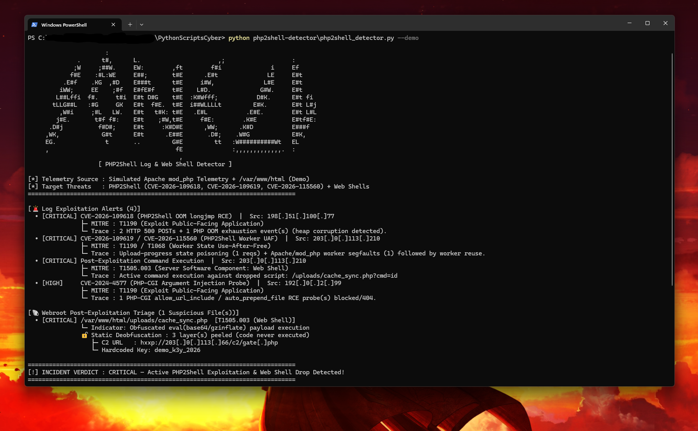

# 🐚 PHP2Shell Log & Web Shell Detector

A rapid-response Blue Team / SOC Threat Hunting CLI tool built to detect active exploitation of the October 2026 **PHP2Shell** core PHP engine vulnerabilities (**`CVE-2026-109618`**, **`CVE-2026-109619`**, and **`CVE-2026-115560`**, CVSS **9.2**), legacy **`CVE-2024-4577`** PHP-CGI probes, and post-exploitation **PHP web shells** across Apache, Nginx, and PHP-FPM servers.

---

## ✨ Features

- **`CVE-2026-109618` (OOM `longjmp` Heap Corruption) Correlation:**
  - Correlates HTTP `500` `POST` bursts in access logs with PHP `Allowed memory size of ... bytes exhausted` and `zend_mm_heap corrupted` teardown errors triggered when an Out-of-Memory `longjmp()` leaves internal hash-table buckets uninitialized.
- **`CVE-2026-109619` & `CVE-2026-115560` (Persistent Worker Use-After-Free) Detection:**
  - Hunts for `PHP_SESSION_UPLOAD_PROGRESS` state poisoning requests and Apache `mod_php` / `PHP-FPM` child worker crashes (`exit signal Segmentation fault (11)` / `fatal_error_backtraces`) followed by rapid state-reuse requests from the same IP.
- **`CVE-2024-4577` PHP-CGI RCE Probe Detection:**
  - Flags automated scanner traffic probing `?%ADd+allow_url_include%3d1` and `auto_prepend_file=php://input`.
- **Static Webroot PHP Web Shell Scanner (`--webroot`):**
  - Scans `.php`, `.phtml`, `.php5`, and `.inc` files for obfuscated web shells (`eval(base64_decode(...))`, `gzinflate()`, `system($_REQUEST[...])`, `passthru()`, `shell_exec()`, `assert()`) and correlates them with HTTP access log command execution hits.
- **🔓 Static Multi-Layer Deobfuscation:**
  - Peels nested `base64_decode` / `gzinflate` / `gzuncompress` / `gzdecode` / `str_rot13` / `strrev` layers (up to 10 deep) using pure `base64` / `zlib` / `codecs` transforms — **the PHP code is never executed**.
  - Extracts IOCs from the decoded payload (C2 URLs, IPs, hardcoded keys/passwords), defangs them, and re-scans the decoded layer for hidden indicators.
- **📜 Sigma & Wazuh Rule Generator (`--export-rules DIR`):**
  - Exports 3 Sigma rules (`.yml`, stable `uuid5` IDs) + a Wazuh `local_rules`-style XML group (levels 12–14 with MITRE IDs) for `CVE-2026-109618`, `CVE-2026-109619`, and web shell access — ready to drop into a SIEM.
- **📡 Real-Time Log Tail Mode (`--follow`) + Webhook Alerts (`--webhook`):**
  - Watches a growing log like `tail -f`, re-correlates a sliding window of recent lines, prints each new alert once, survives log rotation, and can push alerts to Slack/Discord/Teams-style webhooks.

---

## 🎯 MITRE ATT&CK & Threat Advisory Mapping

| Threat / Check | CVE / MITRE ATT&CK ID | Why It Matters |
|---|---|---|
| **PHP Engine OOM `longjmp` RCE** | **`CVE-2026-109618`** (CVSS 9.2) / `T1190` | Pre-auth RCE inside core PHP request teardown before application auth logic runs |
| **Persistent Worker State UAF** | **`CVE-2026-109619` / `CVE-2026-115560`** / `T1190` | Stale pointers in persistent `Apache mod_php` / `PHP-FPM` workers hijacked across requests |
| **Dropped PHP Web Shell Persistence** | **MITRE ATT&CK `T1505.003`** (Server Software Component: Web Shell) | Attackers immediately drop small obfuscated `.php` shells in `/uploads/` or `/cache/` after RCE |
| **PHP-CGI Argument Injection** | **`CVE-2024-4577`** / `T1190` | Frequently bundled with PHP2Shell probes by opportunistic botnets |

---

## 🚀 Usage

### 1. Run Built-in October 2026 PHP2Shell Incident Demo
```bash
python php2shell_detector.py --demo
```

### 2. Scan Apache / Nginx / PHP Logs & a Live Webroot Directory
```bash
python php2shell_detector.py /var/log/apache2/error_and_access.log --webroot /var/www/html
```

### 3. Export SOC Incident Report to JSON
```bash
python php2shell_detector.py --demo -o php2shell_incident.json
```

### 4. Export Sigma & Wazuh Detection Rules
```bash
python php2shell_detector.py --export-rules ./rules
```

### 5. Live-Monitor a Log with Webhook Alerts
```bash
python php2shell_detector.py --follow /var/log/apache2/error.log --webhook https://hooks.slack.com/services/XXX
```

### CLI Options
| Flag | Description |
|---|---|
| `log_file` | Path to an Apache, Nginx, or PHP combined access/error log file |
| `--webroot` | Path to a web server directory to recursively scan for PHP web shells |
| `--demo` | Run built-in October 2026 `Apache mod_php` PHP2Shell incident simulation |
| `-o`, `--output` | Export the full detection report to `.json` |
| `--export-rules DIR` | Write Sigma (`.yml`) + Wazuh (`.xml`) rules to `DIR` |
| `--follow LOGFILE` | Real-time monitoring of a growing log file (`Ctrl+C` to stop) |
| `--webhook URL` | Send `--follow` alerts to a Slack/Discord/Teams webhook |
| `--interval SECONDS` | Poll interval for `--follow` (default `1.0`) |

---

## 📊 Example Output



```text
                      :                                                           
              .      t#,      L.                      ,;                   :      
             ;W     ;##W.     EW:        ,ft        f#i              i     Ef     
            f#E    :#L:WE     E##;       t#E      .E#t              LE     E#t    
          .E#f    .KG  ,#D    E###t      t#E     i#W,              L#E     E#t    
         iWW;     EE    ;#f   E#fE#f     t#E    L#D.              G#W.     E#t    
        L##Lffi  f#.     t#i  E#t D#G    t#E  :K#Wfff;           D#K.      E#t fi 
       tLLG##L   :#G     GK   E#t  f#E.  t#E  i##WLLLLt         E#K.       E#t L#j
         ,W#i     ;#L   LW.   E#t   t#K: t#E   .E#L           .E#E.        E#t L#L
        j#E.       t#f f#:    E#t    ;#W,t#E     f#E:        .K#E          E#tf#E:
      .D#j          f#D#;     E#t     :K#D#E      ,WW;      .K#D           E###f  
     ,WK,            G#t      E#t      .E##E       .D#;    .W#G            E#K,   
     EG.              t       ..         G#E         tt   :W##########Wt   EL     
     ,                                    fE              :,,,,,,,,,,,,,.  :      
                                           ,                                      
                    [ PHP2Shell Log & Web Shell Detector ]

[*] Telemetry Source : Simulated Apache mod_php Telemetry + /var/www/html (Demo)
[*] Target Threats   : PHP2Shell (CVE-2026-109618, CVE-2026-109619, CVE-2026-115560) + Web Shells
============================================================================

[🚨 Log Exploitation Alerts (4)]
  • [CRITICAL] CVE-2026-109618 (PHP2Shell OOM longjmp RCE)  |  Src: 198[.]51[.]100[.]77
               ├─ MITRE : T1190 (Exploit Public-Facing Application)
               └─ Trace : 2 HTTP 500 POSTs + 1 PHP OOM exhaustion event(s) (heap corruption detected).
  • [CRITICAL] CVE-2026-109619 / CVE-2026-115560 (PHP2Shell Worker UAF)  |  Src: 203[.]0[.]113[.]210
               ├─ MITRE : T1190 / T1068 (Worker State Use-After-Free)
               └─ Trace : Upload-progress state poisoning (1 reqs) + Apache/mod_php worker segfaults (1) followed by worker reuse.
  • [CRITICAL] Post-Exploitation Command Execution  |  Src: 203[.]0[.]113[.]210
               ├─ MITRE : T1505.003 (Server Software Component: Web Shell)
               └─ Trace : Active command execution against dropped script: /uploads/cache_sync.php?cmd=id
  • [HIGH]     CVE-2024-4577 (PHP-CGI Argument Injection Probe)  |  Src: 192[.]0[.]2[.]99
               ├─ MITRE : T1190 (Exploit Public-Facing Application)
               └─ Trace : 1 PHP-CGI allow_url_include / auto_prepend_file RCE probe(s) blocked/404.

[🐚 Webroot Post-Exploitation Triage (1 Suspicious File(s))]
  • [CRITICAL] /var/www/html/uploads/cache_sync.php  [T1505.003 (Web Shell)]
               └─ Indicator: Obfuscated eval(base64/gzinflate) payload execution
               🔓 Static Deobfuscation : 3 layer(s) peeled (code never executed)
                  ├─ C2 URL   : hxxp://203[.]0[.]113[.]66/c2/gate[.]php
                  └─ Hardcoded Key: demo_k3y_2026

============================================================================
[!] INCIDENT VERDICT : CRITICAL — Active PHP2Shell Exploitation & Web Shell Drop Detected!
============================================================================
```

---

## 🧠 What I Learned

- **Why Engine-Level Vulnerabilities Bypass App Logs:** Because `CVE-2026-109618` and `CVE-2026-109619` occur inside the C-level PHP interpreter during request parsing and worker cleanup (especially under `Apache mod_php`), application-level audit logs never record the attack. Correlating web server HTTP `500` access logs with low-level PHP OOM and worker `Segmentation fault (11)` error logs is essential to catch exploitation.
- **Defense-in-Depth Webroot Hunting:** Combining network/log telemetry with static webroot scanning (`T1505.003`) immediately tells the SOC whether an RCE probe merely crashed a worker or succeeded in dropping a persistent web shell.
- **Deobfuscate Statically, Never Execute:** PHP's `gzinflate()` is just raw DEFLATE (`zlib.decompress(data, -15)`), so every obfuscation layer can be reversed with pure data transforms. That keeps analysis safe while still revealing the C2 URL and keys hidden inside.
- **Detection-as-Code:** Turning findings into Sigma and Wazuh rules means the detection logic can be shared and deployed across SIEMs instead of living only in a script.

---

## 🔄 Version History & Changelog (`v1.0` → `v2.0`)

| Version | What Was Built / Changed | Why It Changed (Operational Impact) |
|---|---|---|
| **`v1.0`** | Correlated Apache/Nginx HTTP `500` access logs with PHP OOM (`CVE-2026-109618`) and worker segfault (`CVE-2026-109619`) error logs + regex webroot scanning for PHP web shells. | Provided rapid point-in-time incident triage for the October 2026 PHP2Shell advisories, but required manual re-runs, only flagged outer obfuscation wrappers, and kept detection logic locked inside Python. |
| **`v2.0`** | **1. Static Multi-Layer Deobfuscation:** Automatically peels up to 10 nested layers (`base64_decode`, `gzinflate`, `gzuncompress`, `str_rot13`, `strrev`) without ever executing code, extracting embedded C2 URLs and keys.<br>**2. Sigma & Wazuh Rule Generator (`--export-rules`):** Exports portable `.yml` Sigma rules and `.xml` Wazuh `local_rules` definitions.<br>**3. Real-Time Log Tail & Webhook Alerting (`--follow` / `--webhook`):** Watches growing logs continuously, survives log rotation, and pushes live alerts to Slack/Discord/Teams. | **1. Deeper Triage:** Analysts immediately see the hidden C2 infrastructure and authentication keys inside obfuscated shells safely.<br>**2. Detection-as-Code:** Allows SOC teams to deploy the exact PHP2Shell detections straight into enterprise SIEM/XDR pipelines.<br>**3. Continuous Defense:** Turns a static post-incident script into an active 24/7 log monitor. |
