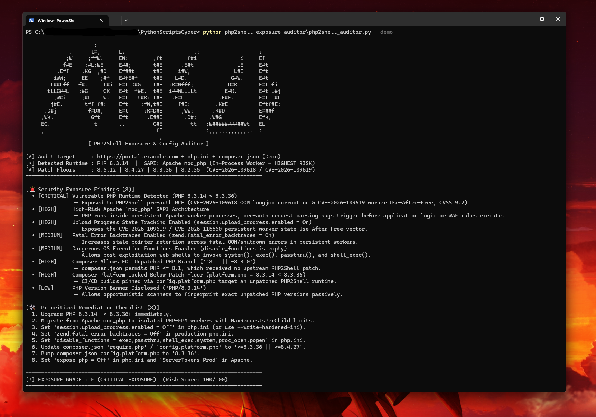

# 🛡️ PHP2Shell Exposure & Config Auditor

A zero-dependency, **100% passive and non-intrusive** Red Team / Vulnerability Assessment CLI tool that audits live HTTP endpoints (`Server`, `X-Powered-By`, single URL or concurrent batch list), `php.ini` runtime directives, `Dockerfile` images, and `composer.json` platform constraints against the October 2026 **PHP2Shell** emergency advisories (**`CVE-2026-109618`**, **`CVE-2026-109619`**, and **`CVE-2026-115560`**, CVSS **9.2**).

---

## ✨ Features

- **October 2026 PHP2Shell Patch-Floor Verification:**
  - Compares discovered PHP versions against the official emergency patched releases (**`8.5.12`**, **`8.4.27`**, **`8.3.36`**, and **`8.2.35`**).
  - Flags End-of-Life (EOL) branches (`PHP <= 8.1`, `8.0`, `7.x`, `5.x`) as `CRITICAL` since no upstream core patches were issued.
- **High-Risk `Apache mod_php` SAPI Detection:**
  - Identifies deployments running `Apache` with in-process `mod_php` (`Server: Apache/... PHP/...` or `libapache2-mod-php` in `Dockerfile`), which the PHP security team singled out as the highest-risk architecture because pre-authentication request parsing executes directly inside persistent Apache worker processes.
- **`php.ini` Runtime Hardening Audit:**
  - Checks `session.upload_progress.enabled` (`CVE-2026-109619` / `CVE-2026-115560` worker state Use-After-Free vector).
  - Checks `zend.fatal_error_backtraces` (stale pointer retention across fatal OOM/shutdown errors).
  - Checks `disable_functions` (post-exploitation web shell execution surface) and `expose_php` (version banner disclosure).
- **📦 `composer.json` Platform & Dependency Constraint Audit (`--composer`):**
  - Inspects `require.php` and `config.platform.php` to catch CI/CD pipelines pinned to EOL PHP branches (`<= 8.1`) or locked below the October 2026 patch floors.
- **⚡ Concurrent Batch Target Scanning (`-i targets.txt`):**
  - Uses `ThreadPoolExecutor` to passively audit lists of subdomains/endpoints concurrently and outputs a sorted exposure matrix (exportable to `.json` or `.csv`).
- **🔧 Auto-Generated Drop-In Hardening Override (`--write-hardened-ini`):**
  - Generates a ready-to-deploy `99-php2shell-hardening.ini` override file for `/etc/php/<version>/<sapi>/conf.d/`.

---

## 🎯 CVE & OWASP Mapping

| Check | CVE / OWASP Reference | Why It Matters |
|---|---|---|
| **Core PHP Version < Patch Floor** | **`CVE-2026-109618` & `CVE-2026-109619`** (CVSS 9.2) / **OWASP A06:2021** | Pre-auth RCE & memory disclosure inside the PHP engine regardless of application code security |
| **Apache `mod_php` Architecture** | **PHP Security Advisory (Oct 2026)** / **OWASP A05:2021** | Persistent worker threads share memory across requests before app-level WAF/auth runs |
| **`session.upload_progress.enabled = On`** | **`CVE-2026-109619` / `CVE-2026-115560`** | Enables multipart upload-progress state poisoning across persistent workers |
| **`composer.json` `platform.php` Pin** | **OWASP A06:2021 (Vulnerable & Outdated Components)** | Prevents developers from upgrading to `8.3.36+` if CI/CD locks dependencies to an older runtime |

---

## 🚀 Usage

### 1. Run Built-in PHP2Shell Exposure, `php.ini` & `composer.json` Audit Demo
```bash
python php2shell_auditor.py --demo
```

### 2. Passively Audit a Live HTTPS Endpoint or Batch List of Targets
```bash
python php2shell_auditor.py https://example.com
python php2shell_auditor.py -i targets.txt -o batch_exposure.csv
```

### 3. Audit Local `php.ini`, `Dockerfile` & `composer.json`
```bash
python php2shell_auditor.py --php-ini /etc/php/8.3/apache2/php.ini --dockerfile ./Dockerfile --composer ./composer.json
```

### 4. Generate a Drop-In `99-php2shell-hardening.ini` Remediation File
```bash
python php2shell_auditor.py --write-hardened-ini ./99-php2shell-hardening.ini
```

### CLI Options
| Flag | Description |
|---|---|
| `target` | Target URL (`https://example.com`) to passively inspect HTTP headers |
| `-i`, `--input-list` | Path to a file of target URLs for concurrent batch auditing |
| `--php-ini` | Path to a local `php.ini` file to audit runtime directives |
| `--dockerfile` | Path to a local `Dockerfile` to inspect PHP base image tags & SAPI packages |
| `--composer` | Path to a local `composer.json` file to audit `require.php` & `config.platform.php` |
| `--write-hardened-ini` | Generate a drop-in `99-php2shell-hardening.ini` mitigation config |
| `--demo` | Run built-in audit against a simulated unpatched `Apache mod_php` target + configs |
| `-o`, `--output` | Export single or batch assessment results to `.json` or `.csv` |

---

## 📊 Example Output



```text
                      :                                                           
              .      t#,      L.                      ,;                   :      
             ;W     ;##W.     EW:        ,ft        f#i              i     Ef     
            f#E    :#L:WE     E##;       t#E      .E#t              LE     E#t    
          .E#f    .KG  ,#D    E###t      t#E     i#W,              L#E     E#t    
         iWW;     EE    ;#f   E#fE#f     t#E    L#D.              G#W.     E#t    
        L##Lffi  f#.     t#i  E#t D#G    t#E  :K#Wfff;           D#K.      E#t fi 
       tLLG##L   :#G     GK   E#t  f#E.  t#E  i##WLLLLt         E#K.       E#t L#j
         ,W#i     ;#L   LW.   E#t   t#K: t#E   .E#L           .E#E.        E#t L#L
        j#E.       t#f f#:    E#t    ;#W,t#E     f#E:        .K#E          E#tf#E:
      .D#j          f#D#;     E#t     :K#D#E      ,WW;      .K#D           E###f  
     ,WK,            G#t      E#t      .E##E       .D#;    .W#G            E#K,   
     EG.              t       ..         G#E         tt   :W##########Wt   EL     
     ,                                    fE              :,,,,,,,,,,,,,.  :      
                                           ,                                      
                    [ PHP2Shell Exposure & Config Auditor ]

[*] Audit Target     : https://portal.example.com + php.ini + composer.json (Demo)
[*] Detected Runtime : PHP 8.3.14  |  SAPI: Apache mod_php (In-Process Worker — HIGHEST RISK)
[*] Patch Floors     : 8.5.12 | 8.4.27 | 8.3.36 | 8.2.35  (CVE-2026-109618 / CVE-2026-109619)
============================================================================

[🚨 Security Exposure Findings (8)]
  • [CRITICAL] Vulnerable PHP Runtime Detected (PHP 8.3.14 < 8.3.36)
               └─ Exposed to PHP2Shell pre-auth RCE (CVE-2026-109618 OOM longjmp corruption & CVE-2026-109619 worker Use-After-Free, CVSS 9.2).
  • [HIGH]     High-Risk Apache 'mod_php' SAPI Architecture
               └─ PHP runs inside persistent Apache worker processes; pre-auth request parsing bugs trigger before application logic or WAF rules execute.
  • [HIGH]     Upload Progress State Tracking Enabled (session.upload_progress.enabled = On)
               └─ Exposes the CVE-2026-109619 / CVE-2026-115560 persistent worker state Use-After-Free vector.
  • [MEDIUM]   Fatal Error Backtraces Enabled (zend.fatal_error_backtraces = On)
               └─ Increases stale pointer retention across fatal OOM/shutdown errors in persistent workers.
  • [MEDIUM]   Dangerous OS Execution Functions Enabled (disable_functions is empty)
               └─ Allows post-exploitation web shells to invoke system(), exec(), passthru(), and shell_exec().
  • [HIGH]     Composer Allows EOL Unpatched PHP Branch ('^8.1 || ~8.3.0')
               └─ composer.json permits PHP <= 8.1, which received no upstream PHP2Shell patch.
  • [HIGH]     Composer Platform Locked Below Patch Floor (platform.php = 8.3.14 < 8.3.36)
               └─ CI/CD builds pinned via config.platform.php target an unpatched PHP2Shell runtime.
  • [LOW]      PHP Version Banner Disclosed ('PHP/8.3.14')
               └─ Allows opportunistic scanners to fingerprint exact unpatched PHP versions passively.

[🛠️  Prioritized Remediation Checklist (8)]
  1. Upgrade PHP 8.3.14 -> 8.3.36+ immediately.
  2. Migrate from Apache mod_php to isolated PHP-FPM workers with MaxRequestsPerChild limits.
  3. Set 'session.upload_progress.enabled = Off' in php.ini (or use --write-hardened-ini).
  4. Set 'zend.fatal_error_backtraces = Off' in production php.ini.
  5. Set 'disable_functions = exec,passthru,shell_exec,system,proc_open,popen' in php.ini.
  6. Update composer.json 'require.php' / 'config.platform.php' to '>=8.3.36 || >=8.4.27'.
  7. Bump composer.json config.platform.php to '8.3.36'.
  8. Set 'expose_php = Off' in php.ini and 'ServerTokens Prod' in Apache.

============================================================================
[!] EXPOSURE GRADE : F (CRITICAL EXPOSURE)  (Risk Score: 100/100)
============================================================================
```

---

## 🧠 What I Learned

- **Safe, Non-Disruptive Vulnerability Auditing:** Memory-corruption vulnerabilities like `CVE-2026-109618` (OOM `longjmp()`) and `CVE-2026-109619` (worker UAF) can crash production web workers if tested with active payloads. Combining passive HTTP header fingerprinting with static `php.ini` / `Dockerfile` / `composer.json` analysis identifies exposure safely with zero production impact.
- **Why SAPI Architecture Matters (`mod_php` vs. `PHP-FPM`):** Even on the same PHP version, `Apache mod_php` embeds the interpreter directly inside the Apache process, allowing pre-auth request parsing bugs to corrupt worker memory before any application firewall or route handler executes.

---

## 🔄 Version History & Changelog (`v1.0` → `v2.0`)

| Version | What Was Built / Changed | Why It Changed (Operational Impact) |
|---|---|---|
| **`v1.0`** | Passive single-target HTTP header (`Server`, `X-Powered-By`) inspection + `php.ini` and `Dockerfile` auditing against the October 2026 PHP2Shell patch floors (`8.5.12`, `8.4.27`, `8.3.36`, `8.2.35`). | Audited individual endpoints and server configs, but couldn't scan large asset lists concurrently, check CI/CD `composer.json` version pins, or auto-generate remediation files. |
| **`v2.0`** | **1. Concurrent Batch Scanning (`-i targets.txt`):** Uses `ThreadPoolExecutor` to audit lists of URLs and export sorted CSV/JSON exposure tables.<br>**2. `composer.json` Constraint Auditing (`--composer`):** Flags `require.php` and `config.platform.php` pins that lock builds to EOL (`<= 8.1`) or unpatched PHP versions.<br>**3. Auto-Generated Hardening Config (`--write-hardened-ini`):** Outputs a drop-in `99-php2shell-hardening.ini` override file. | **1. Attack-Surface Scale:** Lets Red/Purple teams triage dozens of subdomains in seconds.<br>**2. Supply-Chain Coverage:** Catches unpatched PHP runtime pins in source repositories before deployment.<br>**3. Instant Mitigation:** Gives sysadmins a drop-in config to disable `session.upload_progress` and `fatal_error_backtraces` immediately while scheduling a full PHP upgrade. |
