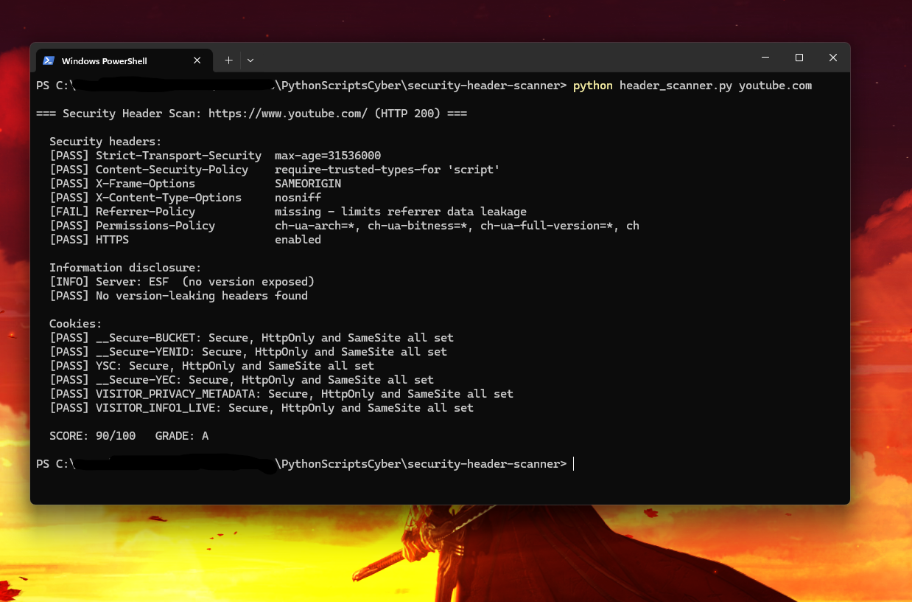

# 🌐 Web Security Header Scanner

A Python tool that checks a website's **HTTP security headers**, cookie flags and information leaks, then gives it a **score and letter grade (A–F)**. It's like a lightweight version of [securityheaders.com](https://securityheaders.com) that runs from your terminal.

## ✨ Features
- Checks 6 key security headers: HSTS, CSP, X-Frame-Options, X-Content-Type-Options, Referrer-Policy, Permissions-Policy
- Flags weak **Content-Security-Policy** settings (`unsafe-inline`, `unsafe-eval`)
- Detects headers that leak **software versions** (`Server: Apache/2.4.41`, `X-Powered-By: PHP/7.4`)
- Checks cookies for the `Secure`, `HttpOnly` and `SameSite` flags
- Scan several sites in one command
- Pure Python standard library, nothing to install

## 🛡️ Why These Headers Matter
| Header | Protects against |
|---|---|
| `Strict-Transport-Security` | SSL stripping / downgrade attacks |
| `Content-Security-Policy` | Cross-site scripting (XSS), data injection |
| `X-Frame-Options` | Clickjacking |
| `X-Content-Type-Options` | MIME-type sniffing |
| `Referrer-Policy` | Leaking URLs to other sites |
| `Permissions-Policy` | Abuse of camera, microphone, location, etc. |

These come up in the **OWASP Top 10** under *A05: Security Misconfiguration*.

## 🚀 Usage
Requires **Python 3.8+** and an internet connection.

```bash
# Scan one site
python header_scanner.py https://example.com

# The https:// part is optional
python header_scanner.py github.com

# Compare several sites
python header_scanner.py example.com github.com
```

> **Note:** The tool sends a single normal `GET` request, the same as opening the page in a browser.

## 📊 Example Output


```
=== Security Header Scan: https://www.youtube.com/ (HTTP 200) ===

  Security headers:
  [PASS] Strict-Transport-Security  max-age=31536000
  [PASS] Content-Security-Policy    require-trusted-types-for 'script'
  [PASS] X-Frame-Options            SAMEORIGIN
  [PASS] X-Content-Type-Options     nosniff
  [FAIL] Referrer-Policy            missing - limits referrer data leakage
  [PASS] Permissions-Policy         ch-ua-arch=*, ch-ua-bitness=*, ch-ua-full-version=*, ch
  [PASS] HTTPS                      enabled

  Information disclosure:
  [INFO] Server: ESF  (no version exposed)
  [PASS] No version-leaking headers found

  Cookies:
  [PASS] __Secure-BUCKET: Secure, HttpOnly and SameSite all set
  [PASS] __Secure-YENID: Secure, HttpOnly and SameSite all set
  [PASS] YSC: Secure, HttpOnly and SameSite all set
  [PASS] __Secure-YEC: Secure, HttpOnly and SameSite all set
  [PASS] VISITOR_PRIVACY_METADATA: Secure, HttpOnly and SameSite all set
  [PASS] VISITOR_INFO1_LIVE: Secure, HttpOnly and SameSite all set

  SCORE: 90/100   GRADE: A
```

## 📐 Scoring
| Check | Points |
|---|---|
| Content-Security-Policy | 25 |
| Strict-Transport-Security | 20 |
| X-Frame-Options | 15 |
| X-Content-Type-Options, Referrer-Policy, Permissions-Policy | 10 each |
| HTTPS enabled | 10 |
| Weak CSP / each version-leaking header | −5 each |

**Grades:** A ≥ 90 · B ≥ 75 · C ≥ 60 · D ≥ 40 · F < 40

## 🧠 What I Learned
- How HTTP response headers protect users in the browser
- Common web misconfigurations from the OWASP Top 10
- Why exposing software versions makes it easier for attackers to find known CVEs

## 🛣️ Future Improvements
- Check HSTS `max-age` length and `preload` readiness
- Export results to JSON or HTML
- Check TLS version and certificate expiry
