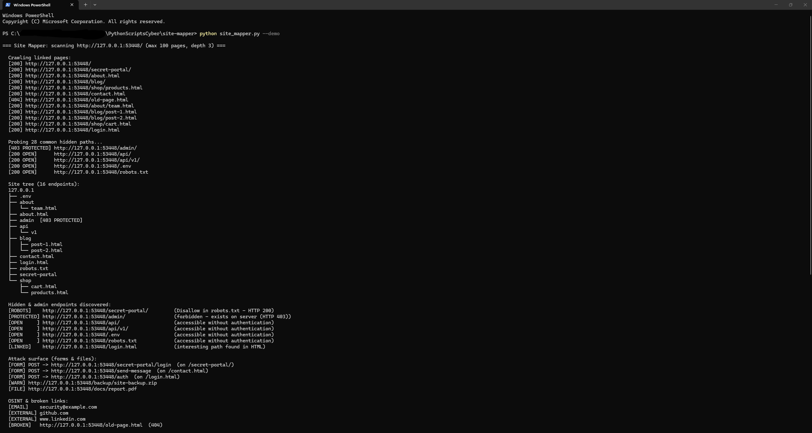

# 🗺️ Website Crawler & Hidden Path Finder

A Python web reconnaissance tool for **pentesting and attack-surface mapping**. Starting from a single URL, it crawls linked pages to build a **visual directory tree**, analyzes **JavaScript bundles (`.js`) for hidden API routes & leaked keys**, harvests paths from `robots.txt` and `sitemap.xml`, and **probes for unlinked hidden endpoints** with **Smart Soft-404 Fingerprinting**.

## ✨ Features
- **5-in-1 Web Reconnaissance Engine:**
  1. **BFS Link Crawler:** Follows internal links and maps every page into a visual folder/file tree
  2. **JavaScript Bundle Route & Secret Extractor:** Parses `<script src="...js">` files to discover hidden API routes (`/api/v1/admin/export`, `/graphql`, `/api/v2/internal/users`) and leaked client-side keys (`sk_live_...`, `AIza...`, `AKIA...`, `ghp_...`)
  3. **`robots.txt` & `sitemap.xml` Harvester:** Extracts `Disallow:` and `<loc>` entries that aren't linked in the HTML
  4. **Smart Soft-404 Fingerprinting + Hidden Path Probe:** Requests a random non-existent UUID path first to baseline custom `"200 OK — Page Not Found"` SPA error pages so only genuine endpoints (`/admin/`, `/.env`, `/backup.zip`) are flagged
  5. **Subdomain Discovery (`--subdomains`):** Queries Certificate Transparency (`crt.sh`) and common subdomain DNS records
- **JSON & Markdown Pentest Report Export (`-o report.json` / `report.md`)**
- **Built-in `--demo` Server:** Spins up a local test website on `127.0.0.1` with JS bundles, `robots.txt`, and hidden endpoints so you can test it safely offline

## 🎯 MITRE ATT&CK & OWASP Mapping
| Framework | Category |
|---|---|
| MITRE ATT&CK | [T1594 — Search Victim-Owned Websites](https://attack.mitre.org/techniques/T1594/) |
| MITRE ATT&CK | [T1595.002 — Active Scanning: Vulnerability Scanning](https://attack.mitre.org/techniques/T1595/002/) |
| OWASP WSTG | [WSTG-CONFIG-04 — Review Old Backup and Unreferenced Files](https://owasp.org/www-project-web-security-testing-guide/) |
| OWASP WSTG | [WSTG-INFO-03 — Review Webserver Metafiles for Information Leakage (`robots.txt` / JS Bundles)](https://owasp.org/www-project-web-security-testing-guide/) |

## 🚀 Usage
Requires **Python 3.10+**. Only scan websites you own or have explicit permission to test.

```bash
# Try it safely against the built-in local demo site
python site_mapper.py --demo

# Scan a target + extract JS routes + discover subdomains + export Markdown report
python site_mapper.py https://example.com --subdomains -o recon_report.md

# Use a custom wordlist of paths to probe
python site_mapper.py https://example.com -w my_wordlist.txt -o report.json
```

| Option | Description |
|---|---|
| `url` | Starting URL to scan |
| `-m`, `--max-pages` | Maximum number of pages to crawl (default: `100`) |
| `-d`, `--depth` | Maximum link depth from the start page (default: `3`) |
| `--delay` | Seconds between requests (default: `0.2`) |
| `-w`, `--wordlist` | Custom file of paths to probe (one path per line) |
| `--no-probe` | Only crawl HTML links (disable hidden-path probing) |
| `--subdomains` | Discover subdomains via Certificate Transparency (`crt.sh`) & DNS |
| `-o`, `--output` | Save output (`.json`, `.md` Markdown report, or `.txt` URL list) |
| `--demo` | Launch and scan the built-in local test website |

## 📊 Example Output


```text
                    [ Site Mapper & Hidden Path Finder v2.0 ]

[*] Target URL    : http://127.0.0.1:57842/
[*] Soft-404 Mode : Standard HTTP 404  |  JS Bundles Analyzed: 1
==============================================================================

  [1] Site Directory Tree (10 live endpoints):
  127.0.0.1
  ├── .env
  ├── about.html
  ├── admin  [403 PROTECTED]
  ├── api
  │   └── v1
  ├── login.html
  ├── robots.txt
  ├── secret-portal
  └── shop
      └── products.html

  [2] Hidden, Admin & JS-Extracted Endpoints:
  [ROBOTS]     /secret-portal/                  (Disallow in robots.txt — HTTP 200 OPEN)
  [PROTECTED]  /admin/                          (forbidden - exists on server (HTTP 403))
  [OPEN     ]  /api/                            (accessible without authentication)
  [OPEN     ]  /api/v1/                         (accessible without authentication)
  [OPEN     ]  /.env                            (accessible without authentication)
  [OPEN     ]  /robots.txt                      (accessible without authentication)
  [JS-ROUTE]   /api/v1/admin/export             (extracted from JavaScript bundle)
  [JS-ROUTE]   /api/v2/internal/users           (extracted from JavaScript bundle)
  [JS-ROUTE]   /graphql                         (extracted from JavaScript bundle)
  [JS-SECRET]  demo_secret_key_998877... (in /static/app.bundle.js)

  [3] Attack Surface (Forms, Sensitive Files & OSINT):
  [FORM]       POST -> /auth                    (on /login.html)
  [SENSITIVE]  /backup/db-dump.sql
  [FILE     ]  /docs/report.pdf
  [EMAIL]      security@example.com

==============================================================================
  SUMMARY: 10 endpoints | 10 hidden/JS routes | 1 JS secrets | 1 forms
==============================================================================
```

## 🛠️ Real-World Debugging & Refinements
After testing the first version on the local demo server, I ran it (with permission) against a friend's live production website — and it immediately froze and produced false positives. Debugging that real target led to three key improvements:

1. **The `sitemap.xml` infinite-loop trap:** The site's `robots.txt` pointed to a `sitemap.xml` with 180+ `<loc>` entries. Separating sitemap URLs from discovered page URLs fixed the hang.
2. **False-positive redirects (`307`/`308`) & SPA Soft-404s:** Modern React/Next.js routers often redirect or return `HTTP 200 OK` with a custom "Not Found" HTML component for every probed URL. Adding redirect verification and **Soft-404 canary fingerprinting** eliminated false-positive `200 OPEN` alerts.
3. **JavaScript bundle inspection:** On Single-Page Applications, most API routes live inside compiled `.js` bundles rather than `<a href>` tags. Parsing `<script src>` bundles uncovered internal `/api/v2/...` and `/graphql` endpoints automatically.

## 🧠 What I Learned
- Why pentesters combine **passive crawling**, **JavaScript bundle analysis**, and **active path discovery**
- How **Soft-404 fingerprinting** (requesting a random non-existent UUID path to baseline `<title>` and content length) solves the #1 false-positive problem on modern SPAs
- How `Disallow:` lines in `robots.txt` and client-side `.js` bundles accidentally expose internal endpoints and API tokens

## 🔄 Version History & Changelog (v1.0 → v2.0)
- **v1.0 (Initial Release):** BFS HTML link crawler, `robots.txt` & `sitemap.xml` harvesting, concurrent hidden-path probing, and ASCII directory tree rendering.
- **v2.0:**
  - Added **JavaScript Bundle Endpoint & Secret Extractor** to parse `<script src="...js">` files for hidden API routes (`/api/v1/...`, `/graphql`) and leaked client-side API keys/tokens.
  - Added **Smart Soft-404 Fingerprinting** to baseline custom `"200 OK — Page Not Found"` SPA responses and eliminate false positives during hidden-path probing.
  - Added **Subdomain Discovery Mode (`--subdomains`)** via Certificate Transparency (`crt.sh`) and DNS resolution.
  - Added **Markdown (`.md`) & JSON Attack-Surface Report Export (`-o`)** and updated the `Def Leppard` `Sonelu` ASCII banner.
