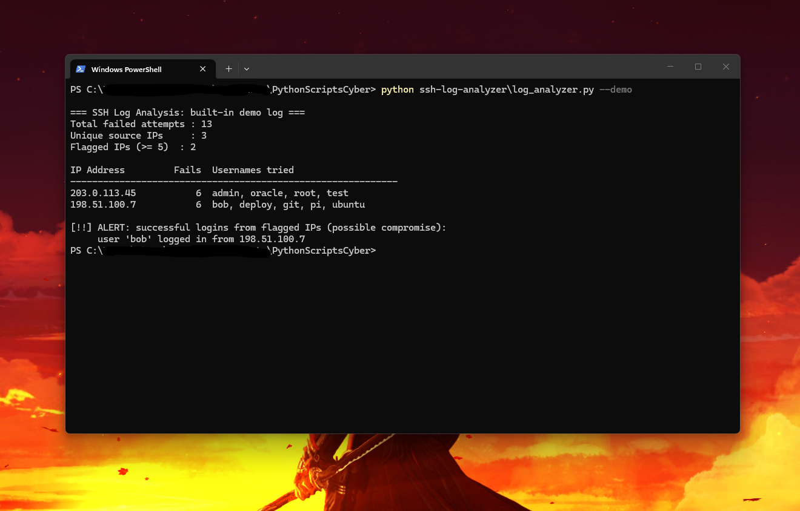

# 🔍 SSH & Auth Log Analyzer

A zero-dependency Python Blue Team / SOC CLI tool that detects **brute-force bursts (sliding time-window analysis)**, **password spraying / username enumeration**, and **post-brute-force account compromises** across both **Linux OpenSSH (`/var/log/auth.log`)** and **Windows Security Event Logs (`Event ID 4625` & `4624`)**.

---

## ✨ Features

- **Cross-Platform Auth Log Parsing:**
  - **Linux OpenSSH (`sshd`):** Parses `Failed password` and `Accepted password/publickey` events from `/var/log/auth.log` or `/var/log/secure`.
  - **Windows Security Auditing (`Event ID 4625` & `4624`):** Automatically extracts failed (`4625`) and successful (`4624`) logons (`TargetUserName`, `IpAddress`, `LogonType`).
- **⏱️ Sliding Time-Window Burst Detection (`-w / --window`):**
  - Calculates the peak number of failed logins within any sliding N-second window (default `60s`), distinguishing high-speed automated brute-force tools (`Hydra`, `Medusa`) from slow human login typos.
- **🎯 Password Spraying vs. Brute-Force Classification:**
  - Automatically tags sources probing `>= 4` distinct usernames as **`T1110.003 Password Spray`** vs. single-account **`T1110.001 Brute Force`**.
- **🔥 Post-Brute-Force Compromise Correlation (`MITRE T1078`):**
  - Raises a `CRITICAL ALERT` if an IP flagged for brute-forcing subsequently logs in successfully.
- **🌍 GeoIP / ASN Attribution (`--geoip`) & JSON/CSV Export (`-o`):**
  - Classifies RFC 1918 LAN vs. External IPs, supports live ASN/Country lookup (`--geoip`), and exports structured `.json` or `.csv` reports.

---

## 🎯 MITRE ATT&CK Mapping

| Detection | MITRE ATT&CK ID | Description |
|---|---|---|
| **Rapid Login Failure Burst** | `T1110.001` (Brute Force: Password Guessing) | High-rate failed attempts against an account within a short sliding window |
| **Multi-Account Probing** | `T1110.003` (Brute Force: Password Spraying) | Single attacker IP enumerating multiple usernames (`root`, `admin`, `svc_sql`) |
| **Post-Failure Login Success** | `T1078` (Valid Accounts) | Flagged attacker IP successfully authenticates via SSH or Windows RDP/Logon |

---

## 🚀 Usage

### 1. Run Built-in Hybrid Linux `sshd` + Windows Event `4625`/`4624` Demo
```bash
python log_analyzer.py --demo
```

### 2. Analyze a Log File with Custom Threshold & Sliding Burst Window
```bash
python log_analyzer.py /var/log/auth.log -t 5 -w 60 --geoip
```

### 3. Export Report to JSON or CSV
```bash
python log_analyzer.py --demo -o auth_report.json
python log_analyzer.py --demo -o auth_report.csv
```

### CLI Options
| Flag | Description |
|---|---|
| `logfile` | Path to a Linux `auth.log` or Windows Security Event log file |
| `-t`, `--threshold` | Failed attempts threshold (default: `5`) |
| `-w`, `--window` | Sliding time-window in seconds for burst detection (default: `60`) |
| `--geoip` | Enable live GeoIP / ASN attribution for public IPs |
| `-o`, `--output` | Export findings to `.json` or `.csv` |
| `--demo` | Run against built-in Linux `sshd` + Windows Event `4625`/`4624` sample log |

---

## 📊 Example Output



```text
                      :                                                           
              .      t#,      L.                      ,;                   :      
             ;W     ;##W.     EW:        ,ft        f#i              i     Ef     
            f#E    :#L:WE     E##;       t#E      .E#t              LE     E#t    
          .E#f    .KG  ,#D    E###t      t#E     i#W,              L#E     E#t    
         iWW;     EE    ;#f   E#fE#f     t#E    L#D.              G#W.     E#t    
        L##Lffi  f#.     t#i  E#t D#G    t#E  :K#Wfff;           D#K.      E#t fi 
       tLLG##L   :#G     GK   E#t  f#E.  t#E  i##WLLLLt         E#K.       E#t L#j
         ,W#i     ;#L   LW.   E#t   t#K: t#E   .E#L           .E#E.        E#t L#L
        j#E.       t#f f#:    E#t    ;#W,t#E     f#E:        .K#E          E#tf#E:
      .D#j          f#D#;     E#t     :K#D#E      ,WW;      .K#D           E###f  
     ,WK,            G#t      E#t      .E##E       .D#;    .W#G            E#K,   
     EG.              t       ..         G#E         tt   :W##########Wt   EL     
     ,                                    fE              :,,,,,,,,,,,,,.  :      
                                           ,                                      
                       [ SSH & Auth Log Analyzer v2.0 ]

[*] Telemetry Source : Built-in Hybrid Demo Log (Linux sshd + Windows Event ID 4625/4624)
[*] Detection Rules  : Threshold >= 5 fails  |  Burst Window: 60s
[*] Summary          : 18 failed logins across 4 IP(s) -> 3 flagged
==============================================================================

[🚨 Flagged Brute-Force & Password-Spraying Sources (3)]
  • 203.0.113.45    | Fails:  6 (Peak 6/60s) | [Linux:sshd] | T1110.003 Password Spray
      ├─ Attribution : TEST-NET-3 (APNIC Doc Block / Simulated Hosting ASN)
      └─ Accounts    : admin, oracle, root, test
  • 198.51.100.7    | Fails:  6 (Peak 6/60s) | [Linux:sshd] | T1110.003 Password Spray
      ├─ Attribution : TEST-NET-2 (ARIN Doc Block / Simulated VPS ASN)
      └─ Accounts    : bob, deploy, git, pi, ubuntu
  • 192.0.2.88      | Fails:  5 (Peak 5/60s) | [WinEvent:4624/WinEvent:4625] | T1110.003 Password Spray
      ├─ Attribution : TEST-NET-1 (IANA Doc Block / Simulated Botnet Node)
      └─ Accounts    : Administrator, adm_domain, svc_backup, svc_sql

[🔥 CRITICAL ALERT: Post-Brute-Force Account Compromise (2) — MITRE T1078]
  • [COMPROMISED] Account 'bob' logged in from flagged IP 198.51.100.7 (Linux:sshd)
  • [COMPROMISED] Account 'svc_backup' logged in from flagged IP 192.0.2.88 (WinEvent:4624)

==============================================================================
```

---

## 🧠 What I Learned

- **Sliding-Window Burst Math:** Using a two-pointer (`left`, `right`) sliding window over sorted event timestamps calculates peak failure bursts in `O(N)` time, avoiding false positives when a legitimate user mistypes their password a few times across an entire week.
- **Unifying Linux & Windows Auth Telemetry:** Mapping Linux `sshd` events and Windows Security Event IDs (`4625` Failed Logon / `4624` Successful Logon) into a single normalized schema lets SOC analysts hunt across mixed Linux/Active Directory environments with one command.

---

## 🔄 Version History & Changelog (`v1.0` → `v2.0`)

| Version | What Was Built / Changed | Why It Changed (Operational Impact) |
|---|---|---|
| **`v1.0`** | Counted total Linux `sshd` failed logins per IP, flagged IPs over a static count threshold, alerts on later login success, and exported basic CSVs. | Could not distinguish 5 failures in 10 seconds from 5 typos over 30 days, only worked on Linux logs, and lacked GeoIP/ASN or password-spraying context. |
| **`v2.0`** | **1. Sliding Time-Window Burst Engine (`-w 60`):** Computes peak failures per N-second window.<br>**2. Windows Event ID `4625`/`4624` Support:** Parses Windows failed & successful logon events alongside Linux `sshd`.<br>**3. Password Spraying (`T1110.003`) & GeoIP/ASN Attribution (`--geoip`):** Classifies multi-account enumeration and network origin.<br>**4. JSON + CSV Export (`-o`) & Updated `Sonelu` Banner.** | **1. Lower False Positives:** Catches rapid automated brute-force bursts accurately.<br>**2. Cross-Platform SOC Coverage:** Audits both Linux servers and Windows Domain Controllers.<br>**3. Faster Triage:** Analysts immediately see whether an attack is targeted password guessing or broad account enumeration. |
