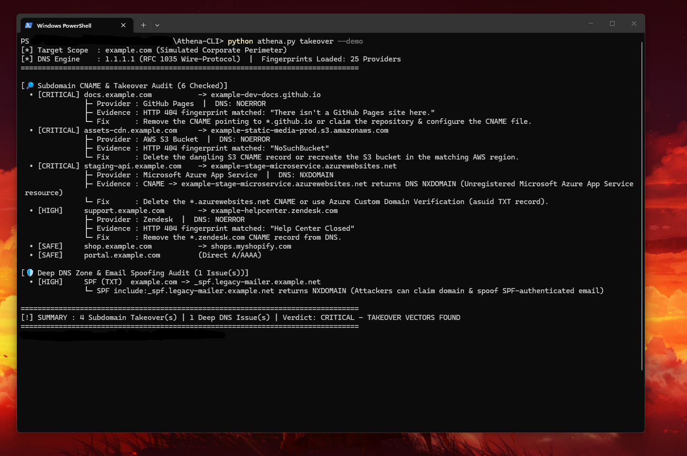

# 🔴 Subdomain Takeover & Dangling DNS Hunter (`v2.0`)

A high-speed, zero-dependency external attack-surface and DNS reconnaissance tool written in pure Python (`struct` + `socket` + `urllib`). It detects orphaned `CNAME` records, dead `NXDOMAIN` cloud endpoints, and dangling `NS` / `MX` / `SPF` records vulnerable to subdomain takeover and domain hijacking.

---

## ✨ Features

- **Raw RFC 1035 DNS Wire-Protocol Resolver:** Encodes and parses binary UDP DNS packets (`A`, `AAAA`, `CNAME`, `NS`, `MX`, `TXT`) with RFC 1035 label pointer decompression (`0xC0`) directly against DNS resolvers (`1.1.1.1` / `8.8.8.8`) without requiring `dnspython`.
- **Multi-Hop CNAME Chain & Dead `NXDOMAIN` Tracer:** Follows CNAME redirects up to 8 hops deep and inspects exact DNS `RCODE` values (`NOERROR`, `NXDOMAIN`, `SERVFAIL`).
- **25+ Cloud & SaaS Provider Takeover Signatures:** Verifies unclaimed cloud endpoints via HTTP/HTTPS banner fingerprinting across **GitHub Pages, AWS S3, AWS CloudFront, Microsoft Azure (App Service, Traffic Manager, Blob/CDN), Heroku, Vercel, Netlify, Shopify, Fastly, Pantheon, Zendesk, Surge.sh, Ghost, Tumblr, WordPress.com, Fly.io, Render, ReadTheDocs, Bitbucket, HelpScout, Unbounce, DigitalOcean, and Google Cloud Storage**.
- **Automated Subdomain Discovery (`--discover`):** Harvests historical subdomains from **Certificate Transparency logs (`crt.sh`)** combined with a built-in wordlist of high-risk CNAME prefixes (`docs`, `dev`, `staging`, `cdn`, `support`, `shop`, `status`, etc.).
- **Deep DNS Zone & Email Spoofing Audit (`--deep-dns`):** Checks delegated `NS` nameservers, `MX` mail servers, and `SPF` (`v=spf1 include:...`) records for expired or `NXDOMAIN` targets.
- **Concurrent Batch Scanning & Reporting (`-t`, `-i`, `-o`):** Multi-threaded scanning via `ThreadPoolExecutor` with one-command export to **JSON** (`.json`) or **Markdown** (`.md`) bug bounty reports.

---

## 🎯 MITRE ATT&CK / OWASP Mapping

| Framework | ID / Category | Technique / Risk |
|---|---|---|
| **MITRE ATT&CK** | `T1584.001` | Compromise Infrastructure: Domains (Subdomain Takeover) |
| **MITRE ATT&CK** | `T1584.004` | Compromise Infrastructure: Server / Cloud Service Hijacking |
| **MITRE ATT&CK** | `T1590.002` | Gather Victim Network Information: DNS |
| **MITRE ATT&CK** | `T1566` | Phishing (Trusted Subdomain & Dangling SPF Include Abuse) |
| **OWASP Top 10** | `A05:2021` | Security Misconfiguration (Orphaned DNS Records & Cloud Assets) |

---

## 🚀 Usage

```bash
# 1. Run the built-in offline corporate takeover demonstration
python takeover_hunter.py --demo

# 2. Audit a single subdomain
python takeover_hunter.py docs.example.com

# 3. Auto-discover subdomains via crt.sh + common prefixes and run Deep DNS audit
python takeover_hunter.py example.com --discover --deep-dns

# 4. Scan a wordlist of subdomains with 25 threads and export a Markdown report
python takeover_hunter.py -i subdomains.txt -t 25 -o takeover_report.md
```

### CLI Options

| Flag | Description |
|---|---|
| `target` | Target subdomain, root domain (with `--discover`), or file path |
| `-i, --input <file>` | File containing a list of subdomains to scan (one per line) |
| `--discover` | Auto-discover subdomains via `crt.sh` Certificate Transparency + common prefixes |
| `--deep-dns` | Also audit `NS`, `MX`, and `SPF include:` records for dangling `NXDOMAIN` targets |
| `--resolver <ip>` | DNS resolver IP to query (default: `1.1.1.1`, fallback: `8.8.8.8`) |
| `-t, --threads <int>` | Number of concurrent worker threads (default: `15`) |
| `--timeout <sec>` | Socket / HTTP timeout in seconds (default: `3.5`) |
| `-o, --output <file>` | Export findings to JSON (`.json`) or Markdown (`.md`) |
| `--demo` | Run deterministic offline demonstration with simulated corporate DNS records |

---

## 📊 Example Output (`--demo`)



```text
[*] Target Scope  : example.com (Simulated Corporate Perimeter)
[*] DNS Engine    : 1.1.1.1 (RFC 1035 Wire-Protocol)  |  Fingerprints Loaded: 25 Providers
================================================================================

[🔎 Subdomain CNAME & Takeover Audit (6 Checked)]
  • [CRITICAL] docs.example.com           -> example-dev-docs.github.io
               ├─ Provider : GitHub Pages  |  DNS: NOERROR
               ├─ Evidence : HTTP 404 fingerprint matched: "There isn't a GitHub Pages site here."
               └─ Fix      : Remove the CNAME pointing to *.github.io or claim the repository & configure the CNAME file.
  • [CRITICAL] assets-cdn.example.com     -> example-static-media-prod.s3.amazonaws.com
               ├─ Provider : AWS S3 Bucket  |  DNS: NOERROR
               ├─ Evidence : HTTP 404 fingerprint matched: "NoSuchBucket"
               └─ Fix      : Delete the dangling S3 CNAME record or recreate the S3 bucket in the matching AWS region.
  • [CRITICAL] staging-api.example.com    -> example-stage-microservice.azurewebsites.net
               ├─ Provider : Microsoft Azure App Service  |  DNS: NXDOMAIN
               ├─ Evidence : CNAME -> example-stage-microservice.azurewebsites.net returns DNS NXDOMAIN (Unregistered Microsoft Azure App Service resource)
               └─ Fix      : Delete the *.azurewebsites.net CNAME or use Azure Custom Domain Verification (asuid TXT record).
  • [HIGH]     support.example.com        -> example-helpcenter.zendesk.com
               ├─ Provider : Zendesk  |  DNS: NOERROR
               ├─ Evidence : HTTP 404 fingerprint matched: "Help Center Closed"
               └─ Fix      : Remove the *.zendesk.com CNAME record from DNS.
  • [SAFE]     shop.example.com           -> shops.myshopify.com
  • [SAFE]     portal.example.com         (Direct A/AAAA)

[🛡️ Deep DNS Zone & Email Spoofing Audit (1 Issue(s))]
  • [HIGH]     SPF (TXT)  example.com -> _spf.legacy-mailer.example.net
               └─ SPF include:_spf.legacy-mailer.example.net returns NXDOMAIN (Attackers can claim domain & spoof SPF-authenticated email)

================================================================================
[!] SUMMARY : 4 Subdomain Takeover(s) | 1 Deep DNS Issue(s) | Verdict: CRITICAL - TAKEOVER VECTORS FOUND
================================================================================
```

---

## 🧠 What I Learned

1. **RFC 1035 Binary DNS Packet Parsing:** How DNS queries and responses are structured at the byte level, including 12-byte headers, `RCODE` bitmasks (`flags & 0x000F`), and `0xC0` pointer compression for domain labels.
2. **HTTP vs. `NXDOMAIN` Takeover Mechanics:** Why some cloud providers (like GitHub Pages and AWS S3) resolve to shared anycast IPs and require HTTP response body fingerprinting (`NoSuchBucket`), while others (like Azure App Service and Traffic Manager) delete the underlying DNS record (`NXDOMAIN`) when a resource is deprovisioned.
3. **Second-Order DNS Hijacking (`SPF` / `MX` / `NS`):** How an expired domain inside an organization's `v=spf1 include:` record allows an attacker to register that domain, publish `v=spf1 +all`, and send fully SPF-authenticated phishing emails on behalf of the target organization.

---

## 🔄 Version History & Changelog (`v1.0` -> `v2.0`)

| Version | Capabilities & Operational Impact |
|---|---|
| **`v1.0` Baseline** | Basic `socket.gethostbyname_ex` alias check with a small list of 5 HTTP error strings. Could not inspect DNS `RCODE` (`NXDOMAIN` vs. `SERVFAIL`) or query `NS`, `MX`, or `TXT` records without external packages. |
| **`v2.0` Full Potential** | Added a **raw RFC 1035 binary UDP DNS wire-protocol client**, **multi-hop CNAME chain tracing**, **25+ cloud/SaaS provider fingerprints**, **automated `crt.sh` subdomain discovery (`--discover`)**, **deep `NS`/`MX`/`SPF` dangling record auditing (`--deep-dns`)**, and **Markdown/JSON report exports (`-o`)**. |
