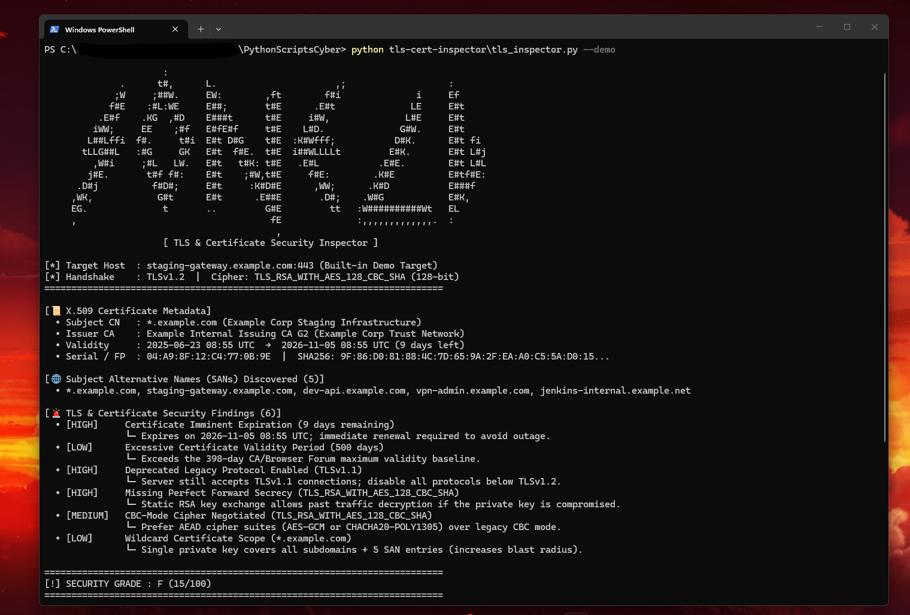

# 🔒 TLS & SSL Certificate Security Inspector

A zero-dependency Python Red Team / Network Security CLI tool that connects to HTTPS endpoints to audit **X.509 certificate chains**, **expiration timelines**, **Subject Alternative Names (SANs)** for subdomain reconnaissance, **TLS protocol versions**, and **negotiated cipher suites** (Grading `A+` to `F`).

---

## ✨ Features

- **Live TLS Handshake & Protocol Probing:**
  - Inspects the negotiated TLS version (`TLSv1.3` / `TLSv1.2`) and actively probes whether the target still accepts deprecated legacy protocols (`TLSv1.0`, `TLSv1.1`).
  - Automatically falls back to unverified certificate extraction (`ssl.CERT_NONE` + `getpeercert(binary_form=True)`) if a target uses a self-signed or expired certificate while flagging the broken trust chain as `CRITICAL`.
- **Cipher Suite & Forward Secrecy Auditing:**
  - Evaluates key exchange and bulk encryption strength, checking for **Perfect Forward Secrecy (`ECDHE` / `DHE` / `TLS 1.3`)** and flagging static RSA key exchanges, legacy `CBC`-mode ciphers, and broken primitives (`RC4`, `3DES`, `NULL`, `EXPORT`, `< 128-bit`).
- **X.509 Certificate Validity & Baseline Compliance:**
  - Calculates exact days remaining until expiration (`CRITICAL` if expired, `HIGH` if `<= 14 days`, `MEDIUM` if `<= 30 days`).
  - Checks total validity against the **398-day CA/Browser Forum maximum lifetime baseline** and computes the `SHA-256` DER certificate fingerprint.
- **Subject Alternative Name (SAN) Attack-Surface Recon:**
  - Extracts all `DNS:` entries embedded in the certificate's `subjectAltName` extension to uncover sibling subdomains, internal staging hosts, and wildcard scope (`*.example.com`).
- **Automated Security Grading (`A+` to `F`) & JSON Export (`-o`):** Produces a single-screen audit report and optional `.json` output.

---

## 🎯 OWASP & NIST Mapping

| Check | Standard / Reference | Security Impact |
|---|---|---|
| **Deprecated `TLSv1.0` / `TLSv1.1` Support** | **RFC 8996 / OWASP A02:2021 (Cryptographic Failures)** | Exposes traffic to protocol downgrade, BEAST, and POODLE attacks |
| **Missing Perfect Forward Secrecy (Static RSA)** | **NIST SP 800-52r2** | If the server's private key is ever stolen, all previously recorded PCAP traffic can be decrypted |
| **Untrusted / Expired X.509 Chain** | **OWASP A05:2021 (Security Misconfiguration)** | Causes service outages or trains users to click through browser MITM warnings |
| **SAN Subdomain Enumeration** | **MITRE ATT&CK `T1596.003` (Search Open Technical Databases: Digital Certificates)** | Reveals internal/dev subdomains sharing a multi-domain TLS certificate |

---

## 🚀 Usage

### 1. Run Built-in TLS & Certificate Security Audit Demo
```bash
python tls_inspector.py --demo
```

### 2. Audit Any Live HTTPS Domain or Custom Port
```bash
python tls_inspector.py example.com
python tls_inspector.py https://github.com
python tls_inspector.py example.com -p 8443
```

### 3. Export Full TLS Audit Report to JSON
```bash
python tls_inspector.py example.com -o tls_report.json
```

### CLI Options
| Flag | Description |
|---|---|
| `target` | Target hostname, `host:port`, or HTTPS URL (`example.com`, `https://example.com:8443`) |
| `--demo` | Run built-in audit against a simulated misconfigured staging HTTPS endpoint |
| `-p`, `--port` | Custom TCP port (default: `443`) |
| `--timeout` | Connection timeout in seconds (default: `6.0`) |
| `-o`, `--output` | Export the full TLS & certificate report to `.json` |

---

## 📊 Example Output



```text
                      :                                                           
              .      t#,      L.                      ,;                   :      
             ;W     ;##W.     EW:        ,ft        f#i              i     Ef     
            f#E    :#L:WE     E##;       t#E      .E#t              LE     E#t    
          .E#f    .KG  ,#D    E###t      t#E     i#W,              L#E     E#t    
         iWW;     EE    ;#f   E#fE#f     t#E    L#D.              G#W.     E#t    
        L##Lffi  f#.     t#i  E#t D#G    t#E  :K#Wfff;           D#K.      E#t fi 
       tLLG##L   :#G     GK   E#t  f#E.  t#E  i##WLLLLt         E#K.       E#t L#j
         ,W#i     ;#L   LW.   E#t   t#K: t#E   .E#L           .E#E.        E#t L#L
        j#E.       t#f f#:    E#t    ;#W,t#E     f#E:        .K#E          E#tf#E:
      .D#j          f#D#;     E#t     :K#D#E      ,WW;      .K#D           E###f  
     ,WK,            G#t      E#t      .E##E       .D#;    .W#G            E#K,   
     EG.              t       ..         G#E         tt   :W##########Wt   EL     
     ,                                    fE              :,,,,,,,,,,,,,.  :      
                                           ,                                      
                      [ TLS & Certificate Security Inspector ]

[*] Target Host  : staging-gateway.example.com:443 (Built-in Demo Target)
[*] Handshake    : TLSv1.2  |  Cipher: TLS_RSA_WITH_AES_128_CBC_SHA (128-bit)
==========================================================================

[📜 X.509 Certificate Metadata]
  • Subject CN   : *.example.com (Example Corp Staging Infrastructure)
  • Issuer CA    : Example Internal Issuing CA G2 (Example Corp Trust Network)
  • Validity     : 2025-06-23 08:53 UTC  →  2026-11-05 08:53 UTC (9 days left)
  • Serial / FP  : 04:A9:8F:12:C4:77:0B:9E  |  SHA256: 9F:86:D0:81:88:4C:7D:65:9A:2F:EA:A0:C5:5A:D0:15...

[🌐 Subject Alternative Names (SANs) Discovered (5)]
  • *.example.com, staging-gateway.example.com, dev-api.example.com, vpn-admin.example.com, jenkins-internal.example.net

[🚨 TLS & Certificate Security Findings (6)]
  • [HIGH]     Certificate Imminent Expiration (9 days remaining)
               └─ Expires on 2026-11-05 08:53 UTC; immediate renewal required to avoid outage.
  • [LOW]      Excessive Certificate Validity Period (500 days)
               └─ Exceeds the 398-day CA/Browser Forum maximum validity baseline.
  • [HIGH]     Deprecated Legacy Protocol Enabled (TLSv1.1)
               └─ Server still accepts TLSv1.1 connections; disable all protocols below TLSv1.2.
  • [HIGH]     Missing Perfect Forward Secrecy (TLS_RSA_WITH_AES_128_CBC_SHA)
               └─ Static RSA key exchange allows past traffic decryption if the private key is compromised.
  • [MEDIUM]   CBC-Mode Cipher Negotiated (TLS_RSA_WITH_AES_128_CBC_SHA)
               └─ Prefer AEAD cipher suites (AES-GCM or CHACHA20-POLY1305) over legacy CBC mode.
  • [LOW]      Wildcard Certificate Scope (*.example.com)
               └─ Single private key covers all subdomains + 5 SAN entries (increases blast radius).

==========================================================================
[!] SECURITY GRADE : F (15/100)
==========================================================================
```

---

## 🧠 What I Learned

- **Parsed vs. Binary DER Certificates in Python's `ssl` Module:** Calling `ssock.getpeercert()` returns a decoded dictionary of `subject`, `issuer`, and `subjectAltName` fields only when certificate verification succeeds, whereas `ssock.getpeercert(binary_form=True)` always returns the raw ASN.1 DER bytes needed to compute the `SHA-256` certificate thumbprint.
- **Why Forward Secrecy Matters:** Even with a valid certificate, using static RSA key exchange means a single future compromise of the server's private key allows an attacker to decrypt years of captured PCAP traffic. Modern deployments should enforce `TLSv1.3` or `TLSv1.2` with `ECDHE` + `AEAD` (`AES-GCM` / `ChaCha20-Poly1305`).
- **SANs as Passive Attack-Surface Recon:** Multi-domain TLS certificates frequently bundle internal or staging hostnames (`dev-api`, `vpn-admin`, `jenkins`) inside the `subjectAltName` extension, exposing hidden infrastructure during a standard TLS handshake.

---

## 🛣️ Future Improvements

- **Certificate Transparency (`crt.sh`) Historical Querying:** Combine live SAN extraction with historical Certificate Transparency logs to find expired/forgotten subdomains.
- **OCSP Stapling & CRL Revocation Check:** Verify whether the certificate has been revoked by its issuing CA and whether OCSP stapling is enabled.
- **Full Cipher Suite Enumeration:** Iterate through individual cipher strings to map every cipher accepted by the target server.
